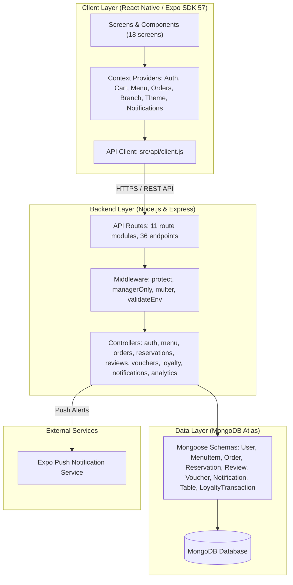

# AURA — Modern Restaurant Management & Dining Platform

<p align="center">
  
</p>

<p align="center">
  <strong>A production-ready, white-label mobile dining and kitchen operations platform.</strong><br>
  Built with React Native (Expo SDK 57), Express.js, and MongoDB Atlas.
</p>

<p align="center">
  
  
  
  
  
  
  
  
  
  
</p>

---

## 🌟 Executive Overview

**AURA** is a high-performance, full-stack restaurant platform engineered for seamless customer dining, real-time kitchen operations, and intelligent business analytics. Designed around modern UX standards, strict role-based access control (RBAC), and an extensible white-label architecture, AURA enables multi-branch restaurant chains to deploy mobile dining, live order tracking, table reservations, loyalty rewards, and promotional campaigns from a single unified codebase.

The platform is architected to operate on **perpetually free cloud infrastructure** (MongoDB Atlas Free Tier, Render Cloud, EAS Free), ensuring zero mandatory subscription overhead for staging and pilot deployments.

---

## 🚀 Key Platform Features

### 📱 Customer Mobile Experience
* **Interactive Menu & Category Navigation**: High-density menu catalog with horizontal category pills, debounced instant search, advanced dietary filter sheet (Halal, Vegetarian, Vegan, Gluten-Free, Dairy-Free), price range slider, and multi-criteria sorting.
* **Chef's Pick & Deals Banner**: Featured dish hero banner with 1-tap add-to-cart and a dynamic "Deals For You" ticker showing live promotional vouchers fetched from the server (auto-hides when empty).
* **Order Again Carousel**: Previous order history displayed as a horizontal carousel for instant 1-tap reordering.
* **Atomic Cart State Machine**: Pure `useReducer` engine handling multi-item carts, promo voucher redemptions, loyalty point redemption (1 pt = Rs. 1, up to 50% bill cap), quantity adjustments, special cooking notes, and automatic price sync.
* **Transparent Bill Breakdown**: Real-time folio showing Subtotal, Voucher Discount, Loyalty Savings, 5% Service Charge, and 15% Provincial Sales Tax (PST/GST) with a clear Grand Total.
* **Live Kitchen Queue Tracking**: 4-stage visual stepper (`Placed` ➔ `Preparing` ➔ `Ready` ➔ `Served`) with animated pulse indicators, elapsed kitchen timer, 5-minute cancellation window, and direct restaurant call button.
* **Multi-Step Table Reservation Engine**: 3-step guided flow — Date/Guests/Zone selection with party size chips → Lunch/Dinner time slot grid with rush-hour warnings → Contact auto-fill with occasion tags (Birthday, Anniversary, Business). Includes booking confirmation screen with reference code and My Bookings tab with 1-tap cancellation.
* **Adaptive Dark & Light Themes**: System-aware, tokenized color palettes with persistent theme caching via AsyncStorage.
* **Guest Browsing & Rapid Onboarding**: Full unauthenticated menu exploration with seamless conversion to registration during checkout.

### 🏷️ Voucher & Loyalty Rewards Engine
* **Server-Validated Coupon System**: Promotional vouchers (`WELCOME10`, `FEAST20`, `AURA30`) validated via dedicated `/api/vouchers/validate` endpoint with percentage or flat-amount discount support.
* **Manager Voucher Controls**: Create, toggle active/inactive status, bulk deactivate demo vouchers, and preview customer-facing ticket chips from the Manager Dashboard.
* **4-Tier VIP Loyalty Program**: Bronze (0–499 pts) → Silver (500–1,499 pts) → Gold (1,500–2,999 pts) → Platinum (3,000+ pts) with tier-based earning multipliers.
* **Automatic Point Earning**: Points awarded on every completed order (1 pt per Rs. 100 × tier multiplier) with full `LoyaltyTransaction` audit ledger.
* **Checkout Redemption**: Direct loyalty point redemption at checkout (1 pt = Rs. 1, capped at 50% of bill).

### ⭐ Verified Reviews & Reputation System
* **Post-Dining Star Rating**: 1-to-5 star rating with comment feedback modal triggered after dining completion.
* **Automated Rating Aggregation**: Server-side recalculation of dish average ratings and review counts stored on each `MenuItem` document.
* **Dish Review Breakdown**: Per-dish star distribution bars (5★ to 1★) with verified customer comments visible on dish detail sheets.
* **Manager Official Replies**: Direct management responses to customer reviews with reply timestamps.

### 🔔 Real-Time Notification Center
* **Live Notification Bell**: Unread count badge in the top header bar with 6-second automatic polling.
* **Notification Feed Screen**: Dedicated feed with relative timestamps ("2m ago"), read/unread filtering, mark-all-read, and individual mark-as-read.
* **Auto-Sliding Toast Banner**: Animated floating banner toast at screen top that auto-triggers on new order status updates.
* **Expo Push Notification Gateway**: Server-side integration with Expo Push Notification Service for native device push alerts on order lifecycle events.

### 👨‍🍳 Manager & Kitchen Operations
* **Business Analytics Dashboard**: Real-time revenue, total orders, average order value (AOV), pending order count, hourly rush bar chart, and top dishes leaderboard — filterable by Today, Last 7 Days, and Last 30 Days.
* **Live Kitchen Pipeline Display**: Dedicated order queue with monotonic state progression (`Start Cooking` → `Mark Ready` → `Mark Served`) and branch-level filtering.
* **Multi-Branch Outlet Management**: Single dashboard to filter orders, tables, and reservations across branch locations (Lahore Gulberg III, Islamabad Blue Area).
* **Reputation Console**: View all customer reviews with sentiment tags and a reply modal for publishing official management responses.
* **Menu Catalog Management**: Full CRUD operations for menu items, price updates, Chef's Special badges, and stock availability toggles.
* **Integrated Photo Upload Pipeline**:
  * **Aspect Ratio Normalization**: Auto-cropped to 4:3 landscape ratio using `expo-image-picker`.
  * **Client Compression**: High-res camera photos (10–25 MB) automatically compressed to ~150–300 KB for rapid network transit.
  * **Secure Multipart Upload**: Streamed to backend via `multer`, validated by MIME type, and hashed with unique cryptographic filenames.
* **Staff Access Management**: Administrative interface to issue, deactivate, and manage manager credentials without direct database intervention.

### 🛡️ Enterprise Security & Auth Architecture
* **Dual-Channel Authentication**: Email/Password authentication restricted to authentic `@gmail.com` domains, and simulated cryptographic 6-digit phone OTP verification with 30-second cooldown.
* **Strict Role-Based Access Control (RBAC)**: Enforced at both API route middleware (`protect`, `managerOnly`) and mobile UI navigator levels.
* **Password Hashing**: Salted and hashed passwords with `bcrypt` (10 rounds).
* **JWT Access Tokens**: Cryptographically signed access tokens with configurable expiration (1-day default).
* **Profile Initialization**: Automatic initials-based avatar generator (e.g., "Farhan Siddiqui" → "FS") with profile info management.

---

## 🏗️ System Architecture



---

## 🛠️ Technology Stack

| Layer | Technology | Key Libraries & Packages |
| :--- | :--- | :--- |
| **Mobile Frontend** | React Native 0.79, Expo SDK 57 | `expo-router`, `expo-image-picker`, `expo-notifications`, `lucide-react-native`, `@react-native-async-storage/async-storage` |
| **Backend API** | Node.js 18+, Express.js 4.21 | `express`, `cors`, `helmet`, `dotenv`, `multer`, `expo-server-sdk` |
| **Database & ODM** | MongoDB, Mongoose 8.x | MongoDB Atlas M0, 9 Mongoose Schemas, Compound Indexes |
| **Authentication** | JWT & Cryptographic OTP | `jsonwebtoken`, `bcryptjs`, Node.js native `crypto` |
| **Testing** | Jest | 67 tests across 6 suites (vouchers, loyalty, reviews, notifications, analytics, integration) |
| **Code Quality** | ESLint, Prettier | Flat config `eslint.config.js`, `.prettierrc`, `.editorconfig` |
| **Cloud Deployment** | Render, MongoDB Atlas | Auto-deploy from GitHub, zero-cost free tier hosting |

---

## ⚡ Quickstart Guide

### Prerequisites
* [Node.js](https://nodejs.org/) (v18.0.0 or higher recommended)
* [npm](https://www.npmjs.com/) (v9.0.0 or higher)
* [Expo Go](https://expo.dev/go) app installed on your physical mobile device (optional, for device testing)

---

### 1. Backend Server Setup

```bash
# 1. Navigate to the server directory
cd server

# 2. Install dependencies
npm install

# 3. Create .env file from template
cp .env.example .env
# (On Windows PowerShell: Copy-Item .env.example .env)

# 4. Open server/.env and verify your configuration:
# PORT=5000
# MONGO_URI=mongodb://127.0.0.1:27017/restaurant_app (or your MongoDB Atlas connection string)
# JWT_SECRET=your_super_secret_jwt_key
# CORS_ORIGINS=http://localhost:19006,http://localhost:8081

# 5. Populate initial database with demo menu, tables, and seeded accounts
npm run seed

# 6. Start the development API server
npm run dev
```

* Backend will be live at: `http://localhost:5000`
* Health check verification: `http://localhost:5000/api/health`

---

### 2. Mobile Client Setup

```bash
# 1. From the project root directory, install dependencies
npm install

# 2. Configure network connection (if testing on physical device):
# Open src/api/client.js and set BASE_URL to your machine's local IP address:
# http://<YOUR_COMPUTER_IP>:5000 (e.g., http://192.168.1.100:5000)

# 3. Start Expo development server
npx expo start
```

* **Desktop Browser**: Press `w` in terminal to launch in web view.
* **Android Emulator**: Press `a` in terminal.
* **iOS Simulator**: Press `i` in terminal (macOS only).
* **Physical Device**: Scan the terminal QR code using **Expo Go** (Android) or **Camera** (iOS) on the same Wi-Fi network.

---

## 🔑 Pre-Seeded Evaluation Accounts

For testing and rapid evaluation, the seed script generates the following pre-configured credentials:

| Account Type | Full Name | Email Address | Password | Privileges |
| :--- | :--- | :--- | :--- | :--- |
| **Executive Manager** | Chef Farhan Siddiqui | `farhan.chef@gmail.com` | `Admin1234` | Full kitchen order progression, table booking approval/decline, menu catalog CRUD, staff account generation. |
| **Dining Guest** | Zainab Malik | `zainab.malik@gmail.com` | `Password123` | Cart operations, promo redemption, order placement, live kitchen tracking, table reservations. |
| **Dining Guest (2)** | Hamza Abbasi | `hamza.abbasi@gmail.com` | `Password1` | Multi-patron customer account for concurrent order testing. |

> **Security Note**: Public user registration (`POST /api/auth/register`) strictly assigns the `customer` role. Administrative manager accounts can only be issued by an authenticated manager or initialized via `npm run seed`.

---

## 📡 REST API Reference

The backend provides **36 REST endpoints** across 11 route modules, adhering to standard HTTP status codes:

<details>
<summary><strong>View Detailed API Endpoints Matrix (36 Endpoints)</strong></summary>

#### Authentication & User Management (11 endpoints)
| Method | Endpoint | Access Level | Description |
| :--- | :--- | :--- | :--- |
| `GET` | `/api/health` | Public | System uptime, timestamp, and health verification |
| `POST` | `/api/auth/register` | Public | Register new customer account (`role: customer`) |
| `POST` | `/api/auth/login` | Public | Authenticate user and issue 24-hour JWT token |
| `GET` | `/api/auth/me` | Authenticated | Retrieve authenticated user profile |
| `PUT` | `/api/auth/profile` | Authenticated | Update user profile details |
| `DELETE` | `/api/auth/profile` | Authenticated | Permanently delete account |
| `GET` | `/api/auth/staff` | Manager Only | List staff accounts with activation statuses |
| `POST` | `/api/auth/staff` | Manager Only | Create new staff/manager account |
| `PATCH` | `/api/auth/staff/:id`| Manager Only | Update staff status or toggle active flag |
| `POST` | `/api/auth/phone/send-otp` | Public | Generate 6-digit cryptographic OTP (30s cooldown) |
| `POST` | `/api/auth/phone/verify-otp` | Public | Verify OTP and authenticate/register customer |

#### Menu & Catalog (5 endpoints)
| Method | Endpoint | Access Level | Description |
| :--- | :--- | :--- | :--- |
| `GET` | `/api/menu` | Public | Retrieve menu catalog with category, text search, and dietary filters |
| `POST` | `/api/menu` | Manager Only | Create new dish entry with image upload |
| `GET` | `/api/menu/:id` | Public | Retrieve single dish details by ObjectId |
| `PUT` | `/api/menu/:id` | Manager Only | Update dish details, pricing, or availability |
| `DELETE` | `/api/menu/:id` | Manager Only | Remove dish from catalog |

#### Orders & Kitchen (4 endpoints)
| Method | Endpoint | Access Level | Description |
| :--- | :--- | :--- | :--- |
| `POST` | `/api/orders` | Authenticated | Place new order into kitchen queue |
| `GET` | `/api/orders` | Manager Only | Retrieve all kitchen orders across branches |
| `GET` | `/api/orders/my` | Authenticated | Retrieve active user's order history |
| `PATCH` | `/api/orders/:id/status`| Authenticated | Monotonic status progression or customer cancellation |

#### Reservations (4 endpoints)
| Method | Endpoint | Access Level | Description |
| :--- | :--- | :--- | :--- |
| `GET` | `/api/tables` | Public | List tables with seating capacities and zones |
| `POST` | `/api/reservations` | Authenticated | Book a table with conflict collision detection |
| `GET` | `/api/reservations/my` | Authenticated | Retrieve active user's reservation history |
| `PATCH` | `/api/reservations/:id` | Authenticated | Update reservation state (`Confirmed`, `Declined`, `Cancelled`) |

#### Reviews & Ratings (6 endpoints)
| Method | Endpoint | Access Level | Description |
| :--- | :--- | :--- | :--- |
| `POST` | `/api/reviews` | Authenticated | Submit star rating and comment for a dish |
| `GET` | `/api/reviews` | Manager Only | Retrieve all customer reviews with sentiment data |
| `GET` | `/api/reviews/my` | Authenticated | Retrieve authenticated user's submitted reviews |
| `GET` | `/api/menu/:id/reviews` | Public | Retrieve reviews and star distribution for a specific dish |
| `PATCH` | `/api/reviews/:id` | Authenticated | Update own review content |
| `PATCH` | `/api/reviews/:id/reply` | Manager Only | Publish official management reply to a review |
| `DELETE` | `/api/reviews/:id` | Authenticated | Delete own review |

#### Vouchers & Promotions (4 endpoints)
| Method | Endpoint | Access Level | Description |
| :--- | :--- | :--- | :--- |
| `GET` | `/api/vouchers/active` | Public | Retrieve all currently active promotional vouchers |
| `POST` | `/api/vouchers/validate` | Authenticated | Server-side coupon validation with discount calculation |
| `PATCH` | `/api/vouchers/:id/toggle` | Manager Only | Toggle voucher active/inactive status |
| `POST` | `/api/vouchers/deactivate-demo` | Manager Only | Bulk deactivate all demo/seed vouchers |

#### Loyalty & VIP Rewards (2 endpoints)
| Method | Endpoint | Access Level | Description |
| :--- | :--- | :--- | :--- |
| `GET` | `/api/loyalty` | Authenticated | Retrieve loyalty points balance, VIP tier, and transaction history |
| `POST` | `/api/loyalty/quote` | Authenticated | Calculate redemption quote (1 pt = Rs. 1, 50% bill cap) |

#### Notifications (6 endpoints)
| Method | Endpoint | Access Level | Description |
| :--- | :--- | :--- | :--- |
| `GET` | `/api/notifications` | Authenticated | Retrieve user's notification feed with timestamps |
| `GET` | `/api/notifications/unread-count` | Authenticated | Get unread notification count for badge display |
| `PATCH` | `/api/notifications/read-all` | Authenticated | Mark all notifications as read |
| `PATCH` | `/api/notifications/:id/read` | Authenticated | Mark individual notification as read |
| `POST` | `/api/notifications/push-token` | Authenticated | Register Expo push notification device token |
| `DELETE` | `/api/notifications/push-token` | Authenticated | Unregister push notification token on logout |

#### Analytics (1 endpoint)
| Method | Endpoint | Access Level | Description |
| :--- | :--- | :--- | :--- |
| `GET` | `/api/analytics/summary` | Manager Only | Revenue, order count, AOV, hourly rush, and top dishes |

#### Media Upload (1 endpoint)
| Method | Endpoint | Access Level | Description |
| :--- | :--- | :--- | :--- |
| `POST` | `/api/upload` | Manager Only | Multipart image upload for dish photography (4:3 aspect ratio) |

</details>

---

## 📂 Repository Structure

```text
├── assets/                    # Application icons, splash screens, and branding
├── docs/                      # Architectural and operational documentation
│   ├── ARCHITECTURE.md        # Technical architecture, layers, and context audit
│   ├── DATABASE.md            # Schema designs, collections, fields, and indexes
│   ├── FREE_STACK.md          # 100% free cloud deployment blueprint
│   ├── WHITE_LABEL.md         # White-label customization and rebranding manual
│   ├── SETUP.md               # Developer configuration and deployment guide
│   ├── ASSETS_LICENSES.md     # Third-party licensing and font audit
│   ├── AI_RULES.md            # AI assistant behavioral guidelines
│   └── PROJECT_LOG.md         # Chronological changelog and development records
├── server/                    # Node.js + Express backend (36 API endpoints)
│   ├── config/                # Database connection & environment validation
│   ├── controllers/           # API request handlers and business logic
│   ├── middleware/            # Auth, RBAC, error handling, and upload filters
│   ├── models/                # Mongoose schemas (User, MenuItem, Order, Reservation,
│   │                          #   Review, Voucher, Notification, Table, LoyaltyTransaction)
│   ├── routes/                # 11 REST endpoint router modules
│   ├── tests/                 # Jest test suites (67 tests across 6 files)
│   ├── uploads/               # Local media storage directory
│   ├── seed.js                # Database initialization and demo data script
│   └── server.js              # Server entry point
├── src/                       # React Native mobile application
│   ├── api/                   # Centralized API client and network handlers
│   ├── components/            # Reusable UI components (NotificationBannerToast, DishReviewsSection, etc.)
│   ├── config/                # Brand manifest and white-label tokens
│   ├── context/               # React Context providers (Auth, Cart, Orders, Theme, Branch,
│   │                          #   Menu, Notifications)
│   ├── hooks/                 # Custom reusable hooks
│   ├── reducers/              # Pure state machines (Cart reducer)
│   ├── screens/               # Screen modules organized by feature domain:
│   │   ├── Menu/              #   Menu browsing, search, deals, dish details
│   │   ├── Cart/              #   Cart, vouchers, loyalty, bill summary
│   │   ├── OrderTracking/     #   Live order status and tracking
│   │   ├── Reservation/       #   Multi-step reservation flow
│   │   ├── Manager/           #   Dashboard, analytics, reviews, vouchers
│   │   └── Login/             #   Auth screens and onboarding
│   └── theme/                 # Design tokens (colors, typography, spacing, shadows)
├── eslint.config.js           # ESLint flat configuration
├── app.json                   # Expo application manifest
├── render.yaml                # Render cloud deployment configuration
└── package.json               # Frontend dependencies and run scripts
```

---

## 📚 Technical Documentation Directory

For deep-dive documentation on specific subsystems, consult the guides in the [`docs/`](docs/) directory:

* 📐 **[Architecture Blueprint](docs/ARCHITECTURE.md)** — Architectural layers, React Context state flow, and security rules.
* 🗄️ **[Database Specification](docs/DATABASE.md)** — MongoDB collections, field constraints, schema rules, and indexing strategy.
* ☁️ **[Free-Stack Service Directory](docs/FREE_STACK.md)** — Free-tier cloud hosting, database, CI/CD, and push notification guides.
* 🎨 **[White-Label Customization Guide](docs/WHITE_LABEL.md)** — Brand tokens, currency localization, multi-outlet configuration.
* 🛠️ **[Local Setup & Environment Guide](docs/SETUP.md)** — Physical device networking, port forwarding, and troubleshooting.
* 📜 **[Asset Licenses & Attributions](docs/ASSETS_LICENSES.md)** — Font, icon, photography, and open-source license compliance.
* 📑 **[Engineering Changelog](docs/PROJECT_LOG.md)** — Complete chronological log of milestones and technical implementations.

---

## 🧪 Quality Assurance & Validation

The codebase undergoes systematic testing, static analysis, and runtime verification:

* **Automated Test Suite**: **67 tests** passing across **6 Jest suites** covering voucher validation, loyalty point calculations, review aggregation, notification delivery, analytics computation, and integration scenarios.
* **Static Analysis**: Verified with ESLint (flat config) and Prettier across all app and server modules.
* **Server Syntax Verification**: Every server module passes automated syntax checking (`node --check server/**/*.js`).
* **Android Production Bundle**: Verified with Expo Android compilation (`expo export --platform android`) producing 0 bundle errors.
* **Deterministic Seeds**: Idempotent database initialization (`npm run seed`) ensures uniform staging across testing environments.
* **Cloud CI/CD**: Render cloud backend automatically syncing with GitHub repository for continuous deployment.

---

## 📄 License

This project is licensed under the [MIT License](LICENSE) — free for personal, educational, and commercial customization.
