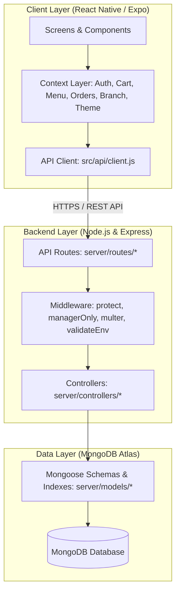

# AURA — Modern Restaurant Management & Dining Platform

<p align="center">
  
</p>

<p align="center">
  <strong>A production-ready, white-label mobile dining and kitchen operations platform.</strong><br>
  Built with React Native (Expo), Express.js, and MongoDB Atlas.
</p>

<p align="center">
  
  
  
  
  
  
  
  
</p>

---

## 🌟 Executive Overview

**AURA** is a high-performance, full-stack restaurant platform engineered for seamless customer dining and efficient kitchen operations. Designed around modern UX standards, strict role-based access control (RBAC), and an extensible white-label architecture, AURA enables multi-branch restaurant chains to deploy mobile dining, real-time kitchen tracking, and table reservations from a single unified codebase.

The entire platform is architected to operate on **perpetually free cloud infrastructure** (MongoDB Atlas Free Tier, Render/Railway, GitHub Pages/EAS Free), ensuring zero mandatory subscription overhead for staging and pilot deployments.

---

## 🚀 Key Platform Features

### 📱 Customer Mobile Experience
* **Interactive Menu & Category Navigation**: Instant catalog browsing with category pills, debounced search, dietary indicators, and real-time item availability.
* **Atomic Cart State Machine**: Pure `useReducer` engine handling multi-item carts, promo voucher redemptions (`WELCOME10`, `FEAST20`, `AURA30`), quantity adjustments, special cooking notes, and automatic price sync.
* **Live Kitchen Queue Tracking**: Real-time order progress timeline (`Pending` ➔ `Preparing` ➔ `Ready` ➔ `Served`) with elapsed timers, dynamic polling, and a 10-minute cancellation safety window.
* **Table Reservation Engine**: Time-slot selection, party size validation, automated double-booking collision prevention (`409 Conflict`), and past-visit history tracking.
* **Adaptive Dark & Light Themes**: System-aware, tokenized color palettes powered by custom theme providers with zero hardcoded UI values.
* **Guest Browsing & Rapid Onboarding**: Full unauthenticated menu exploration with seamless conversion to registration during checkout.

### 👨‍🍳 Manager & Kitchen Operations
* **Live Kitchen Pipeline Display**: Dedicated order queue with monotonic state progression (`Start Cooking`, `Mark Ready`, `Mark Served`).
* **Multi-Branch Outlet Filtering**: Single dashboard to filter orders, tables, and reservations across branch locations (e.g., Lahore, Islamabad).
* **Menu Catalog Management**: Full CRUD operations for menu items, price updates, Chef's Special badges, and stock availability toggles.
* **Integrated Photo Upload Pipeline**:
  * **Aspect Ratio Normalization**: Auto-cropped to 4:3 landscape ratio using `expo-image-picker`.
  * **Client Compression**: High-res camera photos (10–25 MB) automatically compressed to ~150–300 KB for rapid network transit.
  * **Secure Multipart Upload**: Streamed to backend via `multer`, validated by MIME type, and hashed with unique cryptographic filenames.
* **Staff Access Management**: Administrative interface to issue, deactivate, and manage manager credentials without direct database intervention.

### 🛡️ Enterprise Security & Auth Architecture
* **Dual-Channel Authentication**: Email/Password authentication and simulated cryptographic 6-digit phone OTP verification.
* **Strict Role-Based Access Control (RBAC)**: Enforced at both API route middleware (`protect`, `managerOnly`) and mobile UI navigator levels.
* **Password Hashing**: Salted and hashed passwords with `bcrypt` (10 rounds).
* **JWT Access Tokens**: Cryptographically signed access tokens with configurable expiration (1-day default).

---

## 🏗️ System Architecture



---

## 🛠️ Technology Stack

| Layer | Technology | Key Libraries & Packages |
| :--- | :--- | :--- |
| **Mobile Frontend** | React Native, Expo SDK | `expo-router`, `expo-image-picker`, `lucide-react-native`, `@react-native-async-storage/async-storage` |
| **Backend API** | Node.js, Express.js | `express`, `cors`, `helmet`, `dotenv`, `multer` |
| **Database & ODM** | MongoDB, Mongoose | MongoDB Atlas M0, Mongoose Schemas & Compound Indexes |
| **Authentication** | JWT & Cryptographic OTP | `jsonwebtoken`, `bcryptjs`, Node.js native `crypto` |
| **Code Quality** | ESLint, Prettier, TypeScript | Flat config `eslint.config.js`, `.prettierrc`, `.editorconfig` |

---

## ⚡ Quickstart Guide

### Prerequisites
* [Node.js](https://nodejs.org/) (v18.0.0 or higher recommended)
* [npm](https://www.npmjs.com/) (v9.0.0 or higher)
* [Expo Go](https://expo.dev/go) app installed on your physical mobile device (optional, for device testing)

---

### 1. Backend Server Setup

```bash
# 1. Navigate to the server directory
cd server

# 2. Install dependencies
npm install

# 3. Create .env file from template
cp .env.example .env
# (On Windows PowerShell: Copy-Item .env.example .env)

# 4. Open server/.env and verify your configuration:
# PORT=5000
# MONGO_URI=mongodb://127.0.0.1:27017/restaurant_app (or your MongoDB Atlas connection string)
# JWT_SECRET=your_super_secret_jwt_key
# CORS_ORIGINS=http://localhost:19006,http://localhost:8081

# 5. Populate initial database with demo menu, tables, and seeded accounts
npm run seed

# 6. Start the development API server
npm run dev
```

* Backend will be live at: `http://localhost:5000`
* Health check verification: `http://localhost:5000/api/health`

---

### 2. Mobile Client Setup

```bash
# 1. From the project root directory, install dependencies
npm install

# 2. Configure network connection (if testing on physical device):
# Open src/api/client.js and set BASE_URL to your machine's local IP address:
# http://<YOUR_COMPUTER_IP>:5000 (e.g., http://192.168.1.100:5000)

# 3. Start Expo development server
npx expo start
```

* **Desktop Browser**: Press `w` in terminal to launch in web view.
* **Android Emulator**: Press `a` in terminal.
* **iOS Simulator**: Press `i` in terminal (macOS only).
* **Physical Device**: Scan the terminal QR code using **Expo Go** (Android) or **Camera** (iOS) on the same Wi-Fi network.

---

## 🔑 Pre-Seeded Evaluation Accounts

For testing and rapid evaluation, the seed script generates the following pre-configured credentials:

| Account Type | Full Name | Email Address | Password | Privileges |
| :--- | :--- | :--- | :--- | :--- |
| **Executive Manager** | Chef Farhan Siddiqui | `farhan.chef@gmail.com` | `Admin1234` | Full kitchen order progression, table booking approval/decline, menu catalog CRUD, staff account generation. |
| **Dining Guest** | Zainab Malik | `zainab.malik@gmail.com` | `Password123` | Cart operations, promo redemption, order placement, live kitchen tracking, table reservations. |
| **Dining Guest (2)** | Hamza Abbasi | `hamza.abbasi@gmail.com` | `Password1` | Multi-patron customer account for concurrent order testing. |

> **Security Note**: Public user registration (`POST /api/auth/register`) strictly assigns the `customer` role. Administrative manager accounts can only be issued by an authenticated manager or initialized via `npm run seed`.

---

## 📡 REST API Reference

The backend provides **26 REST endpoints** adhering to standard HTTP status codes:

<details>
<summary><strong>View Detailed API Endpoints Matrix (26 Endpoints)</strong></summary>

| Method | Endpoint | Access Level | Description |
| :--- | :--- | :--- | :--- |
| `GET` | `/api/health` | Public | System uptime, timestamp, and health verification |
| `POST` | `/api/auth/register` | Public | Register new customer account (`role: customer`) |
| `POST` | `/api/auth/login` | Public | Authenticate user and issue 24-hour JWT token |
| `GET` | `/api/auth/me` | Authenticated | Retrieve authenticated user profile |
| `PUT` | `/api/auth/profile` | Authenticated | Update user profile details |
| `DELETE` | `/api/auth/profile` | Authenticated | Permanently delete account |
| `GET` | `/api/auth/staff` | Manager Only | List staff accounts with activation statuses |
| `POST` | `/api/auth/staff` | Manager Only | Create new staff/manager account |
| `PATCH` | `/api/auth/staff/:id`| Manager Only | Update staff status or toggle active flag |
| `POST` | `/api/auth/phone/send-otp` | Public | Generate 6-digit cryptographic OTP (30s cooldown) |
| `POST` | `/api/auth/phone/verify-otp` | Public | Verify OTP and authenticate/register customer |
| `GET` | `/api/menu` | Public | Retrieve menu catalog with category and text search |
| `POST` | `/api/menu` | Manager Only | Create new gourmet dish entry |
| `GET` | `/api/menu/:id` | Public | Retrieve single dish details by ObjectId |
| `PUT` | `/api/menu/:id` | Manager Only | Update dish details, pricing, or availability |
| `DELETE` | `/api/menu/:id` | Manager Only | Remove dish from catalog |
| `GET` | `/api/tables` | Public | List tables with seating capacities and zones |
| `POST` | `/api/reservations` | Authenticated | Book a table with conflict collision detection |
| `GET` | `/api/reservations` | Manager Only | Retrieve all restaurant reservations |
| `GET` | `/api/reservations/my` | Authenticated | Retrieve active user's reservation history |
| `PATCH` | `/api/reservations/:id` | Authenticated | Update reservation state (`Confirmed`, `Declined`, `Cancelled`) |
| `POST` | `/api/orders` | Authenticated | Place new dining order into kitchen queue |
| `GET` | `/api/orders` | Manager Only | Retrieve all kitchen orders across branches |
| `GET` | `/api/orders/my` | Authenticated | Retrieve active user's order history |
| `PATCH` | `/api/orders/:id/status`| Authenticated | Monotonic status progression or customer cancellation |
| `POST` | `/api/upload` | Manager Only | Multipart image upload for dish photography (4:3) |

</details>

---

## 📂 Repository Structure

```text
├── assets/                    # Application icons, splash screens, and branding
├── designs/                   # UI design systems, mockups, and screen specs
├── docs/                      # Architectural and operational documentation
│   ├── ARCHITECTURE.md        # Technical architecture, layers, and context audit
│   ├── DATABASE.md            # Schema designs, collections, fields, and indexes
│   ├── FREE_STACK.md          # 100% free cloud deployment blueprint
│   ├── WHITE_LABEL.md         # White-label customization and rebranding manual
│   ├── SETUP.md               # Developer configuration and deployment guide
│   ├── ASSETS_LICENSES.md     # Third-party licensing and font audit
│   └── PROJECT_LOG.md         # Chronological changelog and development records
├── server/                    # Node.js + Express backend
│   ├── config/                # Database connection & environment validation
│   ├── controllers/           # API request handlers and business logic
│   ├── middleware/            # Auth, RBAC, error handling, and upload filters
│   ├── models/                # Mongoose schemas (User, MenuItem, Table, Order, etc.)
│   ├── routes/                # REST endpoint routers
│   ├── uploads/               # Local media storage directory
│   ├── seed.js                # Database initialization script
│   └── server.js              # Server entry point
├── src/                       # React Native mobile application
│   ├── api/                   # Centralized API client and network handlers
│   ├── components/            # Reusable UI components
│   ├── config/                # Brand manifest and white-label tokens
│   ├── context/               # React Context providers (Auth, Cart, Orders, Theme, Branch)
│   ├── hooks/                 # Custom reusable hooks
│   ├── reducers/              # Pure state machines (Cart reducer)
│   ├── screens/               # Screen modules (Menu, Cart, Orders, Reservations, Profile)
│   └── theme/                 # Design tokens (colors, typography, spacing, shadows)
├── eslint.config.js           # ESLint flat configuration
├── app.json                   # Expo application manifest
└── package.json               # Frontend dependencies and run scripts
```

---

## 📚 Technical Documentation Directory

For deep-dive documentation on specific subsystems, consult the guides in the [`docs/`](docs/) directory:

* 📐 **[Architecture Blueprint](docs/ARCHITECTURE.md)** — Architectural layers, React Context state flow, and security rules.
* 🗄️ **[Database Specification](docs/DATABASE.md)** — MongoDB collections, field constraints, schema rules, and indexing strategy.
* ☁️ **[Free-Stack Service Directory](docs/FREE_STACK.md)** — Free-tier cloud hosting, database, CI/CD, and push notification guides.
* 🎨 **[White-Label Customization Guide](docs/WHITE_LABEL.md)** — Brand tokens, currency localization, multi-outlet configuration.
* 🛠️ **[Local Setup & Environment Guide](docs/SETUP.md)** — Physical device networking, port forwarding, and troubleshooting.
* 📜 **[Asset Licenses & Attributions](docs/ASSETS_LICENSES.md)** — Font, icon, photography, and open-source license compliance.
* 📑 **[Engineering Changelog](docs/PROJECT_LOG.md)** — Complete chronological log of milestones and technical implementations.

---

## 🧪 Quality Assurance & Validation

The codebase undergoes systematic static analysis and runtime verification:

* **Static Analysis**: Verified with ESLint and Prettier across all app and server modules.
* **Server Syntax Verification**: Every server module passes automated syntax checking (`node --check server/**/*.js`).
* **Android Production Bundle**: Verified with Expo Android compilation (`expo export --platform android`) producing 0 bundle errors.
* **Deterministic Seeds**: Idempotent database initialization ensures uniform staging across testing environments.

---

## 📄 License

This project is licensed under the [MIT License](LICENSE) — free for personal, educational, and commercial customization.
