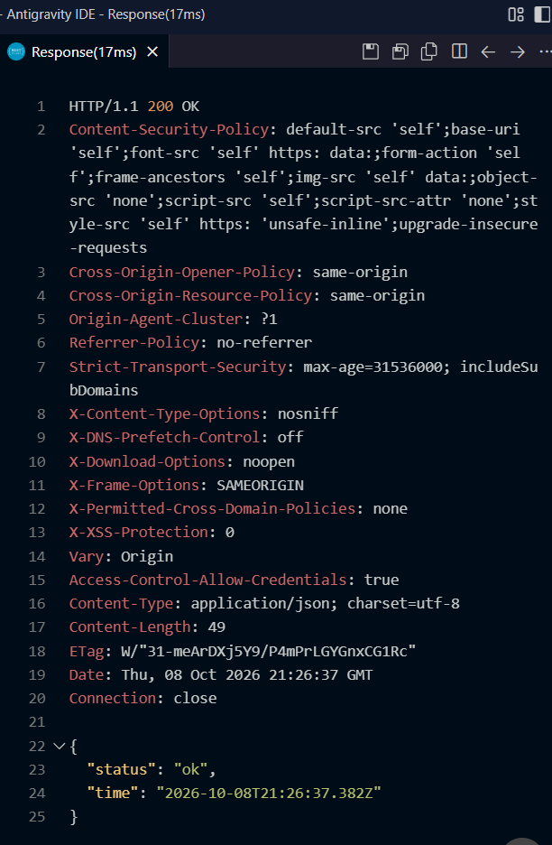
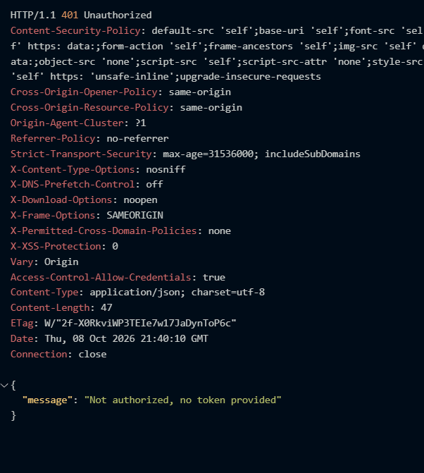
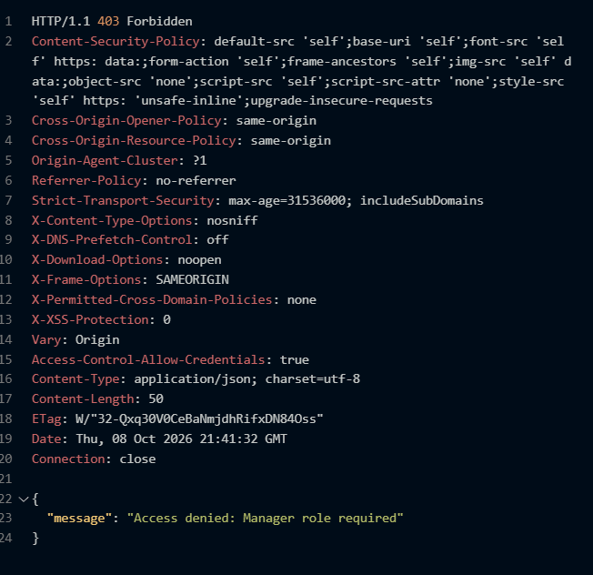
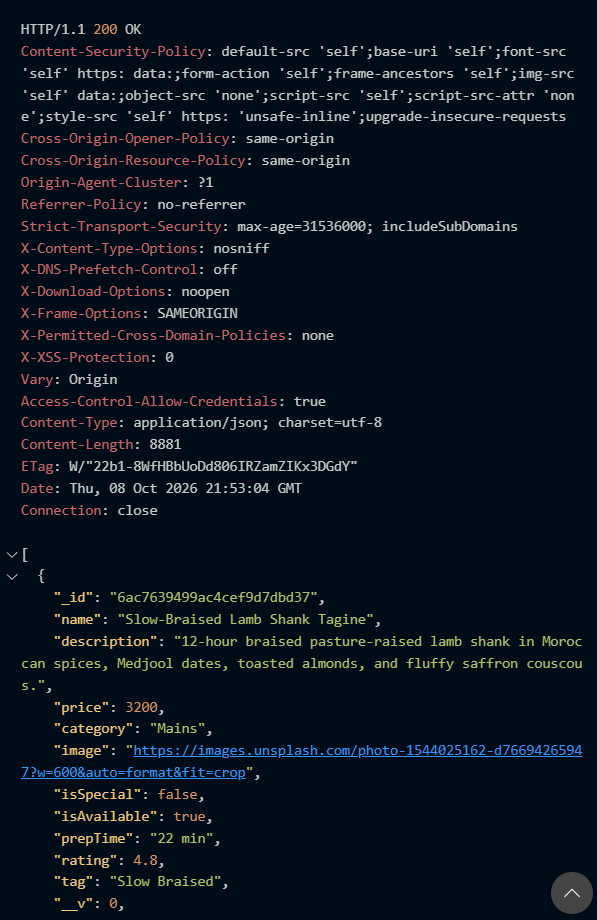
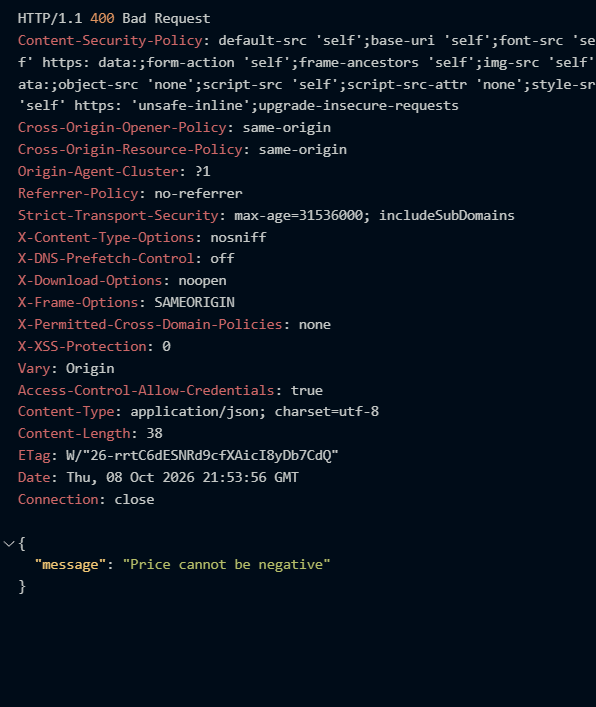
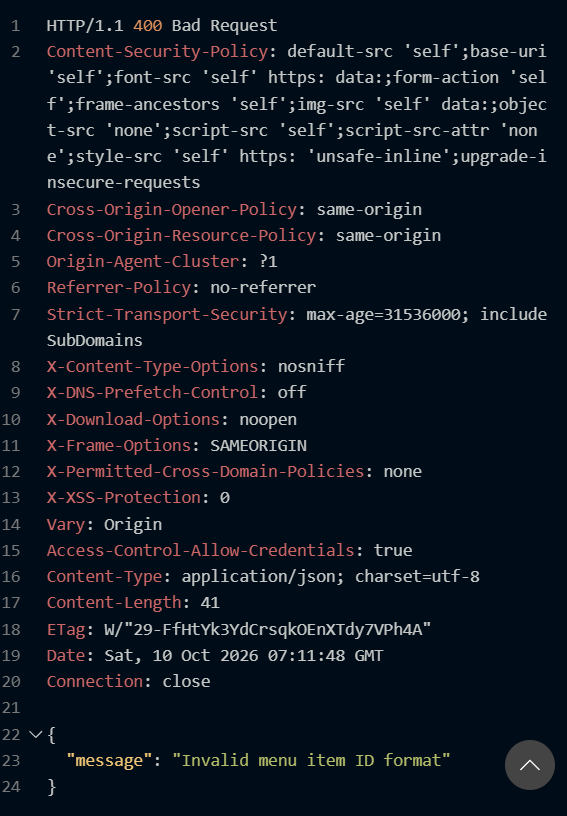
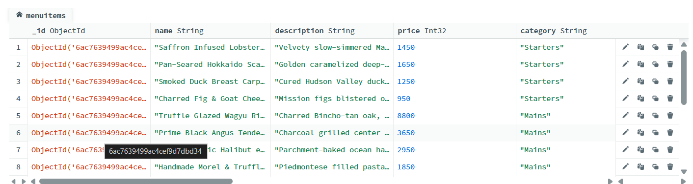
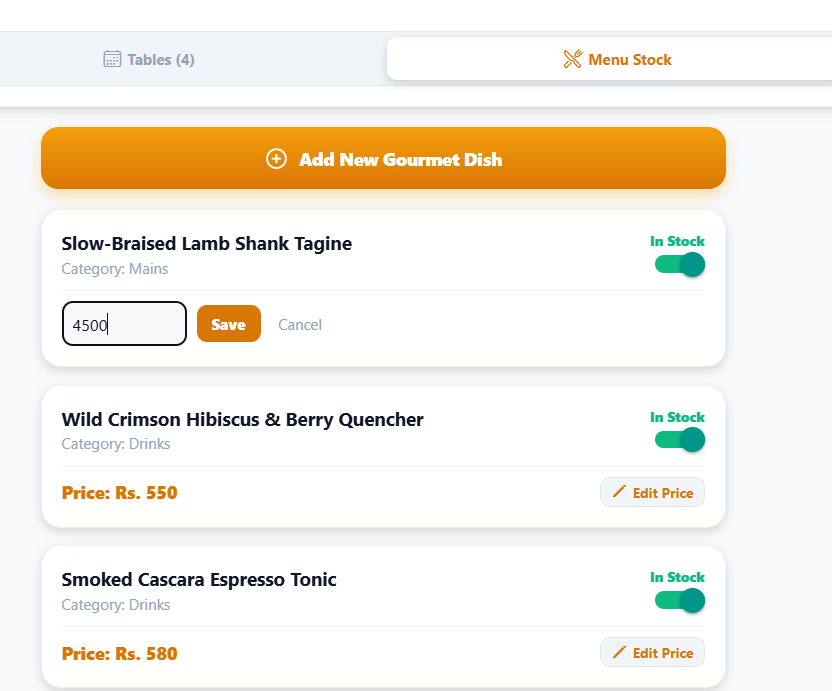
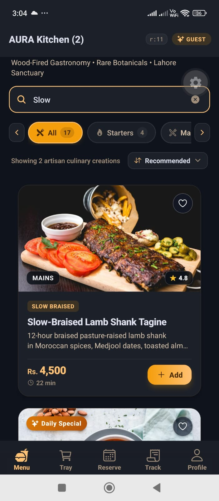

# AURA Restaurant Application

### Student Submission Details
* **Name:** Syed Obaid Ali
* **Roll No:** 9321
* **Subject:** Mobile Application Development (CS-375)
* **Assignment:** Assignment 2 (A2 - Fall 2026)
* **Teacher:** Dr. Sadaf Tanvir

---

A full-stack mobile restaurant application built with **React Native / Expo** and an **Express.js + MongoDB** REST API backend. Key features include JWT-based authentication with role-based access control (Customer and Manager), 6-digit phone OTP login, digital menu browsing with manager image upload, multi-branch outlet management (Lahore & Islamabad), table reservation booking with smart lifecycle states, order tracking with automated status updates, and dark/light theme support.

---

## 1. Submission Deliverables (A2 Folder)

The `docs/academic/A2/` directory contains all required non-code deliverables:
* **`docs/academic/A2/SRS_v2.pdf`**: Comprehensive Software Requirements Specification (v2.0) including:
  * Updated Scope & 10+ Technical Definitions
  * Database Schema Design Tables for 5 MongoDB Collections (`users`, `menuitems`, `tables`, `reservations`, `orders`)
  * Complete REST API Endpoints Specification (23 endpoints)
  * UML Sequence Diagram (`App` ➔ `Express Server` ➔ `MongoDB`)
  * UML Deployment Diagram (Physical architecture, protocols, ports)
* **`docs/academic/A2/restaurant-api.postman_collection.json`**: Postman Collection covering all 23 endpoints across Auth, Menu, Tables, Reservations, Orders, and Health checks. Includes auto-token capture on login.

---

## 2. Technical Documentation & White-Label Guides

Comprehensive guides located in the [`docs/`](docs/) directory:
* **[`docs/SETUP.md`](docs/SETUP.md)** — Complete developer & production setup, seed credentials, network configuration for physical devices, and troubleshooting.
* **[`docs/WHITE_LABEL.md`](docs/WHITE_LABEL.md)** — Rebranding manual for agencies & clients (centralized `brand.js`, theme tokens, currencies, tax rates, assets).
* **[`docs/ASSETS_LICENSES.md`](docs/ASSETS_LICENSES.md)** — Commercial licensing audit for Poppins font (OFL), Ionicons (MIT), Unsplash imagery, and all npm packages.
* **[`docs/ARCHITECTURE.md`](docs/ARCHITECTURE.md)** — Full technical architecture, Context state management, navigation hierarchy, REST endpoints, and security model.

---

## 3. Quick Installation & Execution Guide

### A. Backend Server Setup (Node.js + Express + MongoDB)
```bash
# 1. Navigate to the server folder
cd server

# 2. Install backend dependencies
npm install

# 3. Create .env configuration file (copy from .env.example)
# On Windows PowerShell:
Copy-Item .env.example .env

# 4. Configure server/.env:
# PORT=5000
# MONGO_URI=mongodb://127.0.0.1:27017/restaurant_app
# JWT_SECRET=change_me_to_a_long_random_string
# JWT_EXPIRES_IN=1d
# CORS_ORIGINS=http://localhost:19006,http://localhost:8081

# 5. Seed initial database (creates hashed manager/customer accounts, 16 menu items, 8 tables)
npm run seed

# 6. Start development server with nodemon
npm run dev
# Server will run at http://localhost:5000
# Verify via browser: http://localhost:5000/api/health
```

### B. Mobile App Setup (React Native / Expo)
```bash
# 1. From root directory, install mobile dependencies
npm install

# 2. Configure BASE_URL in src/api/client.js:
# Open src/api/client.js and set BASE_URL based on your environment:
# - Android Emulator:       http://10.0.2.2:5000
# - iOS Simulator:          http://localhost:5000
# - Physical Phone (Expo):  http://<YOUR_COMPUTER_IP>:5000 (e.g., http://192.168.100.17:5000)

# 3. Start Expo development server
npx expo start
```
* **Press `w`**: Opens directly in your desktop browser.
* **Scan QR Code**: Scan via camera (iOS) or **Expo Go** app (Android) connected to the same Wi-Fi.
* **Press `a`**: Launches on Android Emulator.
* **Press `i`**: Launches on iOS Simulator.

---

## 3. Seeded Accounts & Login Credentials

All accounts listed below are **demo accounts provided strictly for testing and academic evaluation**. All passwords in `server/seed.js` are securely hashed using `bcrypt` (10 salt rounds):

| Role | Full Name | Email Address | Password | Permissions & Capabilities |
|---|---|---|---|---|
| **Executive Manager** | Chef Farhan Siddiqui | `farhan.chef@aurabistro.pk` | `Admin1234` | Kitchen order queue progression (`Pending` ➔ `Preparing` ➔ `Ready` ➔ `Served`), Table booking approval/decline, Menu CRUD (Add/Edit items, toggling Chef's Special), Staff account creation via Team tab. |
| **Dining Guest** | Zainab Malik | `zainab.malik@aurabistro.pk` | `Password123` | JWT login/register, live menu browsing, cart reducer, promo vouchers, live order placement, kitchen tracking with 10s polling, table reservations. |
| **Dining Guest (Second)** | Hamza Abbasi | `hamza.abbasi@aurabistro.pk` | `Password1` | Customer dining account for multi-patron testing. |

> **Note on Registration Security:** Public user registration and mobile signup (`POST /api/auth/register` and OTP verification) **always create customer accounts only** (`role: 'customer'`). Client-provided role inputs are strictly ignored. Administrative manager accounts cannot be self-registered; they must be created by an authenticated manager via `POST /api/auth/staff` or seeded through `npm run seed`.
> 
> *(Unified login detects role automatically upon authentication. Passwords are never pre-filled).*

---

## 4. API Endpoints Reference Table

Total: **26 endpoints** implemented in `server/routes/`:

| # | HTTP Method | Endpoint | Access / Auth | Request Body | Response Format & Description |
|---|---|---|---|---|---|
| 1 | `GET` | `/api/health` | Public | None | `200 OK`: `{ status: 'ok', time }` — Server health check. |
| 2 | `POST` | `/api/auth/register` | Public | `{ name, email, password, phone? }` | `201 Created`: `{ token, user }` — Public registration. Always creates role `customer` (client-provided `role` is ignored). |
| 3 | `POST` | `/api/auth/login` | Public | `{ email, password }` | `200 OK`: `{ token, user }` — Validates credentials, returns JWT token (expires in 1 day). Returns `401 Unauthorized` ("Account disabled") if user is inactive. |
| 4 | `GET` | `/api/auth/me` | Protected (`Bearer Token`) | None | `200 OK`: `{ user }` — Returns authenticated user details (without password). |
| 5 | `PUT` | `/api/auth/profile` | Protected (`Bearer Token`) | `{ name?, phone?, dob?, avatar? }` | `200 OK`: `{ message, user }` — Updates current user profile. |
| 6 | `DELETE` | `/api/auth/profile` | Protected (`Bearer Token`) | None | `200 OK`: `{ success: true, message }` — Permanently removes user account from database. |
| 7 | `GET` | `/api/auth/staff` | Manager Only (`protect, managerOnly`) | None | `200 OK`: `User[]` — Lists all manager accounts (`name, email, role, isActive`) without passwords. |
| 8 | `POST` | `/api/auth/staff` | Manager Only (`protect, managerOnly`) | `{ name, email, password }` | `201 Created`: `{ user }` — Creates a new manager account with hashed password (password omitted in response). |
| 9 | `PATCH` | `/api/auth/staff/:id` | Manager Only (`protect, managerOnly`) | `{ isActive?, role? }` | `200 OK`: `{ user }` — Updates staff status (deactivate/reactivate) or demotes to customer. Guarded against self-action and disabling the last manager. |
| 10 | `POST` | `/api/auth/phone/send-otp` | Public | `{ phone }` | `200 OK`: `{ success, message, phone }` — Generates a 6-digit cryptographic OTP for a Pakistani mobile number with a 30s resend cooldown. Code is printed exclusively to the server console as a simulated SMS. |
| 11 | `POST` | `/api/auth/phone/verify-otp` | Public | `{ phone, otp, name? }` | `200 OK` or `201 Created`: `{ token, user, isNewUser }` — Verifies 6-digit OTP and logs in or creates a customer account. Invalidated after 3 incorrect attempts. |
| 12 | `GET` | `/api/menu` | Public | None (Query: `?category=&search=`) | `200 OK`: `MenuItem[]` — Lists menu items with optional category filtering and search. |
| 13 | `POST` | `/api/menu` | Manager Only (`protect, managerOnly`) | `{ name, description, price, category, image, isSpecial?, isAvailable?, prepTime?, rating?, tag? }` | `201 Created`: `MenuItem` — Adds a new gourmet dish to catalog. |
| 14 | `GET` | `/api/menu/:id` | Public | None (`:id` param) | `200 OK`: `MenuItem` — Retrieves single item by MongoDB ObjectId (validates ObjectId format). |
| 15 | `PUT` | `/api/menu/:id` | Manager Only (`protect, managerOnly`) | `{ name?, price?, isAvailable?, isSpecial?, description?, category?, prepTime?, rating?, tag? }` | `200 OK`: `MenuItem` — Updates dish details, price, availability, or specials. |
| 16 | `DELETE` | `/api/menu/:id` | Manager Only (`protect, managerOnly`) | None (`:id` param) | `200 OK`: `{ message, id }` — Permanently deletes a menu item. |
| 17 | `GET` | `/api/tables` | Public | None | `200 OK`: `Table[]` — Lists all restaurant dining tables with seating capacity and zone. |
| 18 | `POST` | `/api/reservations` | Protected (`Bearer Token`) | `{ tableId, date, time, guests, specialRequests?, customerName?, phone? }` | `201 Created`: `Reservation` — Creates table reservation. Validates capacity and returns `409 Conflict` if double-booked. |
| 19 | `GET` | `/api/reservations` | Manager Only (`protect, managerOnly`) | None | `200 OK`: `Reservation[]` — Retrieves all reservations across all users and tables. |
| 20 | `GET` | `/api/reservations/my` | Protected (`Bearer Token`) | None | `200 OK`: `Reservation[]` — Retrieves reservations belonging to the authenticated customer. |
| 21 | `PATCH` | `/api/reservations/:id` | Protected (`Bearer Token`) | `{ status }` (`Confirmed`, `Declined`, `Cancelled`) | `200 OK`: `Reservation` — Manager can set `Confirmed` or `Declined` on any booking; customer can set only `Cancelled` on their own booking. |
| 22 | `POST` | `/api/orders` | Protected (`Bearer Token`) | `{ items: [{ menuItem, name, price, quantity, specialInstructions? }], orderType?, tableNumber?, notes?, branchId?, branchName?, branchCity? }` | `201 Created`: `Order` — Places new order into kitchen queue (`Pending`). Server validates menu items and calculates totals. |
| 23 | `GET` | `/api/orders` | Manager Only (`protect, managerOnly`) | None | `200 OK`: `Order[]` — Retrieves all restaurant orders in the kitchen pipeline. |
| 24 | `GET` | `/api/orders/my` | Protected (`Bearer Token`) | None | `200 OK`: `Order[]` — Retrieves order history for the authenticated customer. |
| 25 | `PATCH` | `/api/orders/:id/status` | Protected (`Bearer Token`) | `{ status }` (`Pending`, `Preparing`, `Ready`, `Served`, `Cancelled`) | `200 OK`: `Order` — Manager advances status forward monotonically; customer can set only `Cancelled` on their own `Pending` order within a 10-minute cancellation window. |
| 26 | `POST` | `/api/upload` | Manager Only (`protect, managerOnly`) | `multipart/form-data` with `image` file | `201 Created`: `{ message, imageUrl, filename, size, mimetype }` — Uploads and stores manager dish photos in `server/uploads/` with 5MB max size and MIME type validation (`jpeg, png, webp`). |

**Phone OTP Authentication (Extra Feature):** The server provides Pakistani mobile phone number OTP login as an additional feature beyond the assignment requirements. `POST /api/auth/phone/send-otp` generates a 6-digit cryptographic numeric code using `crypto.randomInt(100000, 1000000)`, stores it in an in-memory `Map` (not in the database), and prints the code to the server console as a simulated SMS gateway (not returned in the response body). The OTP is valid for 5 minutes with a 30-second resend cooldown per phone number. `POST /api/auth/phone/verify-otp` validates the code (invalidated after 3 incorrect attempts) and either logs in an existing user or creates a new customer account automatically, returning a JWT token.

**Real-World Dish Image Pipeline (KFC / FoodPanda / McDonald's Model):**
When a manager adds or edits a menu item, the app does not require typing raw URLs. Managers can select an image directly from their phone/PC storage:
1. **Standardized Aspect Ratio (4:3):** `expo-image-picker` automatically crops to 4:3 landscape ratio so dish cards render uniformly across all grid and list screens without distortion.
2. **Auto-Compression (70% Quality):** Camera photos (10–25 MB) are automatically compressed client-side before upload, reducing payloads to ~150–300 KB for near-instant upload speeds.
3. **Multipart Server Upload:** Uploaded to `POST /api/upload` via `FormData` protected with manager authentication, validated by `multer`, and stored with unique cryptographic hashes in `server/uploads/`.
4. **Live Thumbnail Preview & Fallback:** Shows immediate thumbnail preview with clear/trash option. Presets and web URL inputs remain available as alternative options.

---

## 5. Hook Usage Matrix by Screen

| Screen | React Core Hooks | Custom Project Hooks | Purpose & Responsibility |
|---|---|---|---|
| **LoginScreen** | `useState`, `useEffect`, `useRef`, `useCallback` | `useAuth`, `useTheme`, `useForm`, `useSafeAreaInsets` | Unified authentication for login, customer registration, and 6-digit cryptographic phone OTP (printed to server console). Includes real-world "Browse Menu as Guest" CTA and remembered email. |
| **MenuScreen** | `useState`, `useEffect`, `useRef`, `useMemo`, `useCallback` | `useApi`, `useTheme`, `useAuth`, `useCart`, `useMenu`, `useBranch`, `useSafeAreaInsets` | Live menu fetch using `useApi('/api/menu')`, category filter chips, debounced search, `React.memo` item cards, and dynamic branch switcher badge. |
| **CartScreen** | `useState`, `useMemo` | `useCart`, `useTheme` | Pure reducer dispatching (`ADD_ITEM`, `REMOVE_ITEM`, `INCREMENT`, `DECREMENT`, `SET_ORDER_TYPE`, `UPDATE_NOTE`, `APPLY_PROMO`, `REMOVE_PROMO`, `CLEAR_CART`, `SYNC_PRICES`), quantity steppers, per-item notes, promo codes (`WELCOME10`, `FEAST20`, `AURA30`), memoized totals. |
| **OrderSummaryScreen** | `useState`, `useMemo` | `useCart`, `useOrders`, `useAuth`, `useTheme`, `useBranch` | Order financial verification (subtotal, taxes, tip), branch outlet routing, dispatches live `POST /api/orders` to backend. |
| **OrderTrackingScreen** | `useState`, `useEffect`, `useRef`, `useCallback`, `useMemo` | `useOrders`, `useAuth`, `useTheme` | Kitchen progression timeline (`Pending` ➔ `Preparing` ➔ `Ready` ➔ `Served`), elapsed timer, cancel countdown (10-minute window), active polling every 10 seconds via `GET /api/orders/my` (stopped when no active order). |
| **ReservationScreen** | `useState`, `useMemo`, `useEffect` | `useReservation`, `useAuth`, `useTheme`, `useBranch`, `useSafeAreaInsets` | Live table selection via `/api/tables`, booking dispatch to `/api/reservations`, `BranchChip` location switching, `409 Conflict` collision handling. Smart reservation lifecycle: past/completed bookings auto-display "Dining Completed • Visited" badge with "Reserve Again" CTA; cancel button only visible for future active bookings. Filter tabs (All, Upcoming, Past, Cancelled) with live count badges. |
| **ManagerDashboardScreen** | `useState`, `useCallback` | `useApi`, `useAuth`, `useTheme`, `useOrders`, `useMenu` | Multi-branch order & reservation filtering via outlet pills (`All Outlets`, `📍 Lahore`, `📍 Islamabad`) with prominent branch city badges on cards, live order progression (`Start Cooking`, `Mark Ready`, `Mark Served`), menu catalog CRUD with dish image upload (Photo URL input + Quick Photo Presets: Steak, Pasta, Burger, Dessert, Mocktail, Salad from Unsplash), "App View" button for customer-perspective preview, staff management via Team tab. |
| **ProfileScreen** | `useState`, `useEffect` | `useAuth`, `useTheme`, `useOrders`, `useReservation` | User profile details inspection, guest state card with Sign In CTA, dark/light theme toggle, role badge, safeStorage session management, JWT logout. |

> **Architecture Note:**  
> Context API is used for auth, theme, cart, orders, and multi-branch management (`BranchContext`) to avoid prop drilling across screens. The cart uses `useReducer` with a pure reducer because it has many related transitions (add, remove, quantity, notes, promo, clear), ensuring predictable and atomic state updates. Meanwhile, simple local form fields use `useState`.

---

## 6. Security & Environment Variable Policy

* **`.env` Exclusion**: In accordance with enterprise security practices, the real `.env` file containing secrets, database credentials, and JWT signing keys is **strictly ignored** by `.gitignore` and has never been pushed to Git.
* **`.env.example` Keys**: A safe template file is provided at `server/.env.example` with standard placeholders only:
  * `PORT=5000`
  * `MONGO_URI=your_mongodb_atlas_connection_string_here`
  * `JWT_SECRET=your_super_secret_key_here`
  * `JWT_EXPIRES_IN=1d`
  * `CORS_ORIGINS=http://localhost:19006,http://localhost:8081`
* **Password Hashing**: Passwords are never stored in plaintext. They are salted and hashed with `bcrypt` (10 rounds).
* **JWT Expiration**: Access tokens are signed using a server-side secret with a 24-hour expiration (`1d`).

---

## 7. Demonstration Video & Screenshots

* **Assignment 1 Video**: [Watch A1 Demo Video on GitHub](https://github.com/obaids093-prog/Restaurant-app-mvp/blob/main/docs/academic/A1/demo_video.mp4)
* **Assignment 2 Demo Video (max 4 minutes)**: [Watch A2 Demo Video](docs/academic/A2/demo-video2.mp4)
* **UML & Diagrams**: Included in high resolution inside `docs/academic/A2/SRS_v2.pdf` and `docs/academic/A1/UML/Untitled Diagram-Page-1.drawio.png`.

### Screenshots & Test Evidence

#### Available Image Files in `docs/academic/A2/screenshots/`:
* `200statusok.png`
* `customerloginok.png`
* `deletetestdish 200-ok.png`
* `manager200-ok.png`
* `managerloginok.png`
* `menu 201-created.png`
* `menu-negative-price-400.png`
* `menu-success.png`
* `menu400bad request.png`
* `menuitemcollection1.png`
* `menuitemcollection2.png`
* `menupostcutomertokenok.png`
* `menupostok.png`
* `newprice-customer.jpeg`
* `phone-health.jpeg`
* `price-manager.png`

#### Test Execution & Verification Evidence:
* **Health Route on Laptop (`/api/health` - 200 OK)**: 
* **Health Route on Mobile Device (`/api/health`)**: 
* **Menu POST with No Token (401 Unauthorized)**: 
* **Menu POST with Customer Token (403 Forbidden)**: 
* **Menu POST with Manager Token (201 Created)**: 
* **Successful Request (200 OK)**: 
* **Menu POST with Negative Price (400 Bad Request)**: 
* **Menu GET with Invalid ID (400 Bad Request)**: 
* **MongoDB Atlas `menuitems` Collection**: 
* **Price Change on Manager Device**: 
* **New Price on Customer Device (Real-Time Sync)**: 

* **Existing Repository Assets**:
  * `assets/icon.png` (App Launcher Icon)
  * `assets/splash-icon.png` (Splash Screen Icon)
  * `assets/favicon.png` (Web Favicon)
  * `docs/academic/A1/UML/Untitled Diagram-Page-1.drawio.png` (System Architecture & UML Diagram)

---

## 8. Formal Test Case Verification Table

| Test ID | Module | Description | Pre-condition | Steps | Expected | Actual | Status |
|---|---|---|---|---|---|---|---|
| **TC-AUTH-01** | Auth | Successful customer authentication | User exists in DB with valid password | 1. Enter `zainab.malik@aurabistro.pk`<br>2. Enter `Password123`<br>3. Tap "Sign In to AURA" | HTTP 200 returned, JWT token stored, user context loaded, redirect to Menu | User authenticated, token persisted in safeStorage, navigates to Menu | Pass |
| **TC-AUTH-02** | Auth | Rejection of invalid credentials | Registered user email | 1. Enter `zainab.malik@aurabistro.pk`<br>2. Enter wrong password<br>3. Tap "Sign In to AURA" | HTTP 401 Unauthorized with "Invalid email or password" error | Inline error banner displays "Invalid email or password"; state remains unauthenticated | Pass |
| **TC-AUTH-03** | Auth | Rejection of duplicate email registration | Email already exists in DB | 1. Tap "Sign up"<br>2. Fill name, existing email & valid password<br>3. Tap "Create Customer Account" | HTTP 409 Conflict with "An account with this email already exists" | Inline error banner displays "An account with this email already exists" | Pass |
| **TC-ROLE-01** | Role Switching | Manager role access to kitchen queue & controls | Logged in as manager (`farhan.chef@aurabistro.pk`) | 1. Log in with manager account<br>2. Check navigation tabs | Manager Dashboard opens with Orders, Tables, Menu Stock, and Team tabs | Manager Dashboard accessible with active queue, booking approval, and staff creation | Pass |
| **TC-ROLE-02** | Role Switching | Customer role forbidden from manager operations | Logged in as customer (`zainab.malik@aurabistro.pk`) | 1. Log in as customer<br>2. Check UI and invoke manager endpoints (e.g. POST `/api/auth/staff`) | Manager dashboard hidden in client; direct API calls to manager routes return HTTP 403 Forbidden | Manager tab hidden in client; unauthorized endpoints return HTTP 403 ("Access denied: Manager role required") | Pass |
| **TC-CART-01** | Cart Reducer | Add menu item and calculate subtotal | Menu items loaded, cart empty | 1. Tap "+" on Saffron Infused Lobster Bisque (Rs. 1,450)<br>2. Open Cart screen | Reducer handles `ADD_ITEM`, subtotal updates to Rs. 1,450, count is 1 | Cart renders 1x item at Rs. 1,450; subtotal is Rs. 1,450 | Pass |
| **TC-CART-02** | Cart Reducer | Apply valid promo voucher code | Active items in cart | 1. Enter voucher "WELCOME10"<br>2. Tap "Apply" | Reducer handles `APPLY_PROMO`, applies 10% discount to subtotal | 10% discount line item calculated and deducted from total | Pass |
| **TC-CART-03** | Cart Reducer | Decrement item quantity to zero removes item | Cart contains 1 item (qty: 1) | 1. Tap "-" button on item | Reducer handles `DECREMENT`, item removed from list | Item removed; empty cart placeholder shown | Pass |
| **TC-RES-01** | Reservations | Book dining table for available slot | User authenticated, table free | 1. Pick date, party size 2, slot 19:00<br>2. Tap "Review Booking"<br>3. Confirm in modal | POST `/api/reservations` creates booking with status "Pending" | Reservation created, booking ID issued, appears in My Bookings | Pass |
| **TC-RES-02** | Reservations | Collision prevention for already booked slot | Table already reserved for slot | 1. Submit duplicate booking for same table, date & slot | Backend rejects with HTTP 409 Conflict: "This table is already booked for the selected date and time slot." | HTTP 409 Conflict returned; UI presents collision message | Pass |
| **TC-RES-03** | Reservations | Customer cancels own reservation | Active booking exists in My Bookings | 1. Open My Bookings tab<br>2. Tap "Cancel Reservation"<br>3. Confirm prompt | PATCH `/api/reservations/:id` updates status to "Cancelled" | Status badge updates to "Cancelled"; table slot released | Pass |
| **TC-RES-04** | Reservations | Past/completed reservations hide cancel button | Booking date has passed or status is Completed | 1. Open My Bookings tab<br>2. View past reservation card | Cancel button hidden; "Dining Completed • Visited" badge displayed with "Reserve Again" CTA | Past booking shows green checkmark badge with "Reserve Again" button; no cancel option visible | Pass |
| **TC-RES-05** | Reservations | Reservation filter tabs with counts | Multiple bookings in various states | 1. Open My Bookings tab<br>2. Switch between All, Upcoming, Past, Cancelled tabs | Each tab filters bookings by state and shows accurate count badges | Tabs correctly filter; counts match actual booking states | Pass |
| **TC-ORD-01** | Orders | Place dining order from cart | Items present in cart | 1. Proceed to Order Summary<br>2. Tap "Dispatch Order to Kitchen" | POST `/api/orders` creates order with status "Pending"; cart cleared via `CLEAR_CART` | Order record saved, cart emptied, routed to Order Tracking | Pass |
| **TC-ORD-02** | Orders | Customer cancels own pending order | Order status is "Pending" within 10-minute cancellation window | 1. Open Order Tracking screen<br>2. Tap "Cancel Order"<br>3. Confirm cancellation | PATCH `/api/orders/:id/status` sets status to "Cancelled" | Status transitions to "Cancelled", polling stops, UI reflects cancellation | Pass |
| **TC-ORD-03** | Orders | Manager advances kitchen order status | Order in "Pending" status | 1. Open Manager Dashboard<br>2. Tap "Start Cooking" on order | PATCH `/api/orders/:id/status` updates status to "Preparing" | Order updates to "Preparing" in manager queue and customer tracker | Pass |
| **TC-ORD-04** | Orders | Multi-branch order filtering | Orders placed from Lahore and Islamabad branches | 1. Open Manager Dashboard → Orders tab<br>2. Tap "📍 Lahore" filter pill<br>3. Tap "📍 Islamabad" filter pill | Only orders from selected branch are displayed; branch city badge visible on each order card | Branch filter correctly shows/hides orders; city badge displayed prominently | Pass |
| **TC-MENU-01** | Menu CRUD | Manager adds dish with image preset | Manager logged in on Add Dish modal | 1. Open Menu Stock tab<br>2. Tap "+ Add New Dish"<br>3. Fill details, tap "🍔 Burger" preset<br>4. Save | New dish created with Unsplash burger image URL via POST `/api/menu` | Dish appears in catalog with correct image; preset URL populated in Photo URL field | Pass |
