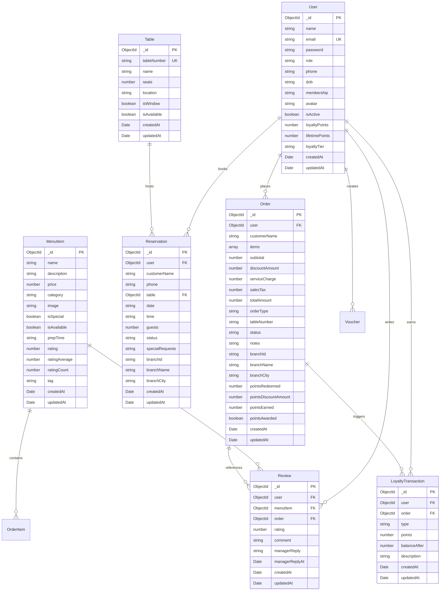

# Database Documentation & Seed Hygiene

> **Living Technical Reference**: Generated from live Mongoose schemas located in `server/models/`.  
> **ORM / Driver**: Mongoose `^8.3.4` on MongoDB Atlas.  
> **Last Verified**: Phase 1 (Product Foundation).

---

## 1. Overview & Architecture

The backend leverages **MongoDB Atlas** managed document storage accessed via **Mongoose**. 
- Database connection lifecycle is managed in `server/config/db.js` using persistent connection pooling.
- A pre-flight warm-up query executes on initialization to ensure immediate sub-millisecond query latency for cold client requests.
- All primary collections enforce standard MongoDB ObjectIds (`_id`), automatic timestamps (`createdAt`, `updatedAt`), and strict validation at both model and index tiers.



---

## 2. Collections and Schema Reference

### 2.1 Collection: `users` (Model: `User` in `server/models/User.js`)

Stores customer and administrative staff accounts with encrypted credentials and loyalty profiles.

| Field | Type | Required | Default | Enum / Constraints | Relations / Validation |
| :--- | :--- | :---: | :--- | :--- | :--- |
| `_id` | `ObjectId` | Auto | Auto | MongoDB ObjectId | Primary Key |
| `name` | `String` | Yes | — | `trim: true` | Validation: `'Please provide a name'` |
| `email` | `String` | Yes | — | `unique: true`, `lowercase: true`, `trim: true` | Validation regex: `/^\w+([.-]?\w+)*@\w+([.-]?\w+)*(\.\w{2,3})+$/` |
| `password` | `String` | Yes | — | `minlength: 6` | Bcrypt salt hash (stored after hash generation) |
| `role` | `String` | No | `'customer'` | `['customer', 'manager']` | Access-control role flag |
| `phone` | `String` | No | `''` | `trim: true` | Customer contact telephone |
| `dob` | `String` | No | `''` | `trim: true` | Date of birth string (e.g. `'YYYY-MM-DD'`) |
| `membership`| `String` | No | `'Member'` | Freeform string | Loyalty tier badge (e.g. `'VIP Emerald Patron'`) |
| `avatar` | `String` | No | Unsplash URL | Valid URI string | Default profile image URL |
| `isActive` | `Boolean` | No | `true` | Boolean flag | Account status toggle |
| `pushTokens` | `[String]` | No | `[]` | Array of strings | Registered Expo device push tokens |
| `loyaltyPoints` | `Number` | No | `0` | `min: 0` | Current redeemable loyalty points balance |
| `lifetimePoints` | `Number` | No | `0` | `min: 0` | Total points earned across all orders (drives tier) |
| `loyaltyTier` | `String` | No | `'Bronze'` | `['Bronze', 'Silver', 'Gold', 'Platinum']` | Calculated tier based on lifetimePoints thresholds |
| `createdAt`| `Date` | Auto | Current Time | Managed by Mongoose | Timestamp |
| `updatedAt`| `Date` | Auto | Current Time | Managed by Mongoose | Timestamp |

**Indexes**:
- `email_1`: `{ email: 1 }` (`unique: true`) — Case-insensitive unique user identity constraint.

---

### 2.2 Collection: `menuitems` (Model: `MenuItem` in `server/models/MenuItem.js`)

Catalog of culinary offerings, pricing, categorization, and kitchen preparation metadata.

| Field | Type | Required | Default | Enum / Constraints | Relations / Validation |
| :--- | :--- | :---: | :--- | :--- | :--- |
| `_id` | `ObjectId` | Auto | Auto | MongoDB ObjectId | Primary Key |
| `name` | `String` | Yes | — | `trim: true` | Validation: `'Please provide an item name'` |
| `description` | `String` | Yes | — | `trim: true` | Validation: `'Please provide a description'` |
| `price` | `Number` | Yes | — | `min: 0` | Validation: `'Price cannot be negative'` |
| `category` | `String` | Yes | — | `['Starters', 'Mains', 'Desserts', 'Drinks']` | Validation: `'{VALUE} is not a valid category'` |
| `image` | `String` | Yes | — | `trim: true` | URL path or remote CDN image location |
| `isSpecial` | `Boolean` | No | `false` | Boolean flag | Featured/Chef signature item flag |
| `isAvailable` | `Boolean` | No | `true` | Boolean flag | Real-time 86'd / inventory toggle |
| `prepTime` | `String` | No | `'15 min'` | `trim: true` | Estimated prep duration |
| `rating` | `Number` | No | `0` | `min: 0`, `max: 5` | Backward-compatible display rating |
| `ratingAverage` | `Number` | No | `0` | `min: 0`, `max: 5` | Recalculated dynamic average rating |
| `ratingCount` | `Number` | No | `0` | `min: 0` | Total verified reviews count |
| `tag` | `String` | No | `''` | `trim: true` | Culinary label (e.g., `'A5 Miyazaki'`, `'Wild Caught'`) |
| `createdAt` | `Date` | Auto | Current Time | Managed by Mongoose | Timestamp |
| `updatedAt` | `Date` | Auto | Current Time | Managed by Mongoose | Timestamp |

**Indexes**:
- Text Search: `{ name: 'text', description: 'text' }` — Optimized text search across name and description fields.
- Category Filter: `{ category: 1 }` — High-efficiency category query index.

---

### 2.3 Collection: `tables` (Model: `Table` in `server/models/Table.js`)

Floor-plan seating inventory for restaurant reservations and dine-in tracking.

| Field | Type | Required | Default | Enum / Constraints | Relations / Validation |
| :--- | :--- | :---: | :--- | :--- | :--- |
| `_id` | `ObjectId` | Auto | Auto | MongoDB ObjectId | Primary Key |
| `tableNumber` | `String` | Yes | — | `unique: true`, `trim: true` | Unique identifier (e.g. `'A-01'`, `'M-05'`) |
| `name` | `String` | Yes | — | `trim: true` | Descriptive seating label (e.g. `'Atrium Window'`) |
| `seats` | `Number` | Yes | — | `min: 1` | Seating capacity |
| `location` | `String` | Yes | — | `trim: true` | Dining zone (e.g. `'Glasshouse Atrium'`) |
| `isWindow` | `Boolean` | No | `false` | Boolean flag | Window-adjacent attribute |
| `isAvailable` | `Boolean` | No | `true` | Boolean flag | Physical availability status |
| `createdAt` | `Date` | Auto | Current Time | Managed by Mongoose | Timestamp |
| `updatedAt` | `Date` | Auto | Current Time | Managed by Mongoose | Timestamp |

**Indexes**:
- `tableNumber_1`: `{ tableNumber: 1 }` (`unique: true`) — Unique table numbering constraint.

---

### 2.4 Collection: `reservations` (Model: `Reservation` in `server/models/Reservation.js`)

Table reservation bookings, party sizes, and operational lifecycle state.

| Field | Type | Required | Default | Enum / Constraints | Relations / Validation |
| :--- | :--- | :---: | :--- | :--- | :--- |
| `_id` | `ObjectId` | Auto | Auto | MongoDB ObjectId | Primary Key |
| `user` | `ObjectId` | Yes | — | References `User` model | FK: `ref: 'User'` |
| `customerName` | `String` | No | — | `trim: true` | Denormalized booking contact name |
| `phone` | `String` | No | — | `trim: true` | Denormalized booking contact phone |
| `table` | `ObjectId` | Yes | — | References `Table` model | FK: `ref: 'Table'` |
| `date` | `String` | Yes | — | `trim: true` (e.g. `'2026-10-15'`) | ISO Calendar date |
| `time` | `String` | Yes | — | `trim: true` (e.g. `'19:00'`) | Service timeslot string |
| `guests` | `Number` | Yes | — | `min: 1` | Party size count |
| `status` | `String` | No | `'Pending'` | `['Pending', 'Confirmed', 'Completed', 'No-Show', 'Cancelled', 'Declined']` | Reservation lifecycle status |
| `specialRequests` | `String` | No | `''` | `trim: true` | Guest notes / dietary requests |
| `branchId` | `String` | No | `'lhr_gulberg'` | `trim: true` | Branch identifier key |
| `branchName` | `String` | No | `'AURA • Gulberg III, Lahore'` | `trim: true` | Branch display name |
| `branchCity` | `String` | No | `'Lahore'` | `trim: true` | Branch city |
| `createdAt` | `Date` | Auto | Current Time | Managed by Mongoose | Timestamp |
| `updatedAt` | `Date` | Auto | Current Time | Managed by Mongoose | Timestamp |

**Indexes**:
- Compound Partial Unique Index (Double-Booking Prevention):
  - Fields: `{ table: 1, date: 1, time: 1 }`
  - Options: `{ unique: true, partialFilterExpression: { status: { $in: ['Pending', 'Confirmed'] } } }`
- Customer Lookup: `{ user: 1 }` — Fast retrieval of patron booking histories.
- Date/Time Lookup: `{ date: 1, time: 1 }` — Fast lookup for daily restaurant shift rosters.

---

### 2.5 Collection: `orders` (Model: `Order` in `server/models/Order.js`)

Customer food and beverage orders, checkout bill breakdowns, and kitchen fulfillment statuses.

#### Embedded Sub-Schema: `orderItemSchema` (`Order.items[]`)
| Field | Type | Required | Default | Enum / Constraints | Relations / Validation |
| :--- | :--- | :---: | :--- | :--- | :--- |
| `_id` | `ObjectId` | Auto | Auto | MongoDB ObjectId | Sub-document identifier |
| `menuItem` | `ObjectId` | Yes | — | References `MenuItem` model | FK: `ref: 'MenuItem'` |
| `name` | `String` | Yes | — | String | Snapshot of item name at purchase |
| `price` | `Number` | Yes | — | `min: 0` | Snapshot of item unit price at purchase |
| `quantity` | `Number` | Yes | `1` | `min: 1` | Item quantity ordered |
| `specialInstructions` | `String` | No | `''` | `trim: true` | Item customization notes |

#### Parent Order Document Fields
| Field | Type | Required | Default | Enum / Constraints | Relations / Validation |
| :--- | :--- | :---: | :--- | :--- | :--- |
| `_id` | `ObjectId` | Auto | Auto | MongoDB ObjectId | Primary Key |
| `user` | `ObjectId` | Yes | — | References `User` model | FK: `ref: 'User'` |
| `customerName` | `String` | No | — | `trim: true` | Denormalized customer name |
| `items` | `[orderItemSchema]` | Yes | — | Array must contain $\ge 1$ item | Custom validation: `items.length > 0` |
| `subtotal` | `Number` | No | `0` | `min: 0` | Sum of item unit prices $\times$ quantities |
| `discountAmount`| `Number` | No | `0` | `min: 0` | Promotional coupon / loyalty deductions |
| `promoCode` | `String` | No | `null` | `trim: true` | Applied promotional coupon code |
| `serviceCharge` | `Number` | No | `0` | `min: 0` | Hospitality service charge |
| `salesTax` | `Number` | No | `0` | `min: 0` | Provincial sales tax |
| `totalAmount` | `Number` | Yes | — | `min: 0` | Net payable balance |
| `orderType` | `String` | No | `'Dine-in'` | `['Dine-in', 'Takeaway', 'Dine-In Table', 'Curbside', 'Priority']` | Order delivery/fulfillment channel |
| `tableNumber` | `String` | No | `''` | `trim: true` | Assigned dining table |
| `status` | `String` | No | `'Pending'` | `['Pending', 'Preparing', 'Ready', 'Served', 'Cancelled']` | Kitchen order lifecycle |
| `notes` | `String` | No | `''` | `trim: true` | Special prep / allergy instructions |
| `branchId` | `String` | No | `'lhr_gulberg'` | `trim: true` | Multi-branch routing key |
| `branchName` | `String` | No | `'AURA • Gulberg III, Lahore'` | `trim: true` | Branch display name |
| `branchCity` | `String` | No | `'Lahore'` | `trim: true` | Branch location city |
| `pointsRedeemed` | `Number` | No | `0` | `min: 0` | Loyalty points redeemed for this order |
| `pointsDiscountAmount` | `Number` | No | `0` | `min: 0` | Rs. discount from redeemed points (1 pt = Rs. 1) |
| `pointsEarned` | `Number` | No | `0` | `min: 0` | Loyalty points earned from this order |
| `pointsAwarded` | `Boolean` | No | `false` | Boolean flag | Whether points have been credited to patron |
| `createdAt` | `Date` | Auto | Current Time | Managed by Mongoose | Timestamp |
| `updatedAt` | `Date` | Auto | Current Time | Managed by Mongoose | Timestamp |

**Indexes**:
- User History Index: `{ user: 1, createdAt: -1 }` — High-speed retrieval of customer order receipts sorted chronologically.
- Kitchen Status Index: `{ status: 1 }` — High-speed live order queue filtering for manager/kitchen displays.
- Analytics Date-Status Compound Index: `{ createdAt: -1, status: 1 }` — High-performance date range filtering and aggregation across non-cancelled order metrics.
- Multi-Branch Analytics Compound Index: `{ branchId: 1, createdAt: -1 }` — Filtered branch timeline queries and regional revenue analysis.

---

### 2.6 Collection: `reviews` (Model: `Review` in `server/models/Review.js`)

Patron reviews, 1-to-5 star ratings, and management responses for menu items ordered in served restaurant orders.

| Field | Type | Required | Default | Enum / Constraints | Relations / Validation |
| :--- | :--- | :---: | :--- | :--- | :--- |
| `_id` | `ObjectId` | Auto | Auto | MongoDB ObjectId | Primary Key |
| `user` | `ObjectId` | Yes | — | References `User` model | FK: `ref: 'User'` |
| `menuItem` | `ObjectId` | Yes | — | References `MenuItem` model | FK: `ref: 'MenuItem'` |
| `order` | `ObjectId` | Yes | — | References `Order` model | FK: `ref: 'Order'` |
| `rating` | `Number` | Yes | — | `min: 1`, `max: 5`, integer | Score from 1 (Poor) to 5 (Outstanding) |
| `comment` | `String` | No | `''` | `trim: true`, `maxlength: 300` | Optional tasting notes / review text |
| `managerReply` | `String` | No | `''` | `trim: true`, `maxlength: 300` | Official chef/manager response |
| `managerReplyAt`| `Date` | No | `null` | Date | Timestamp of manager response |
| `createdAt` | `Date` | Auto | Current Time | Managed by Mongoose | Timestamp |
| `updatedAt` | `Date` | Auto | Current Time | Managed by Mongoose | Timestamp |

**Indexes**:
- Unique Review per Order Item: `{ user: 1, order: 1, menuItem: 1 }` (`unique: true`) — Enforces one review per dish per served order.
- Dish Reviews Sorting: `{ menuItem: 1, createdAt: -1 }` — High-speed paginated retrieval of reviews for a dish.

---

### 2.7 Collection: `vouchers` (Model: `Voucher` in `server/models/Voucher.js`)

Promotional coupons, percentage/fixed discounts, usage counters, and outlet restrictions.

| Field | Type | Required | Default | Enum / Constraints | Relations / Validation |
| :--- | :--- | :---: | :--- | :--- | :--- |
| `_id` | `ObjectId` | Auto | Auto | MongoDB ObjectId | Primary Key |
| `code` | `String` | Yes | — | `unique: true`, `uppercase: true`, `trim: true` | Voucher redemption code |
| `description` | `String` | No | `''` | `trim: true` | Promotional copy / privilege summary |
| `discountType` | `String` | Yes | `'percentage'` | `['percentage', 'fixed']` | Calculation formula |
| `discountValue` | `Number` | Yes | — | `min: 0` (max 100 if percentage) | Discount magnitude |
| `minOrderAmount`| `Number` | No | `0` | `min: 0` | Basket subtotal threshold required |
| `maxDiscountAmount`| `Number` | No | `null` | `min: 0` | Ceiling cap on percentage savings |
| `validFrom` | `Date` | No | Current Time | Date | Activation timestamp |
| `validUntil` | `Date` | Yes | — | Date | Expiration timestamp |
| `usageLimit` | `Number` | No | `null` | `min: 1` | Global redemption cap |
| `usageCount` | `Number` | No | `0` | `min: 0` | Atomic redemption counter |
| `isActive` | `Boolean` | No | `true` | Boolean | Administrative toggle |
| `applicableBranchId`| `String` | No | `'all'` | Branch key or `'all'` | Outlet restriction |
| `createdBy` | `ObjectId` | No | — | References `User` model | FK: `ref: 'User'` (manager) |
| `createdAt` | `Date` | Auto | Current Time | Managed by Mongoose | Timestamp |
| `updatedAt` | `Date` | Auto | Current Time | Managed by Mongoose | Timestamp |

**Indexes**:
- Active Code Lookup: `{ code: 1, isActive: 1 }` — Fast validation lookup at cart checkout.
- Expiration Maintenance: `{ validUntil: 1 }` — Expiry scans and cleanup.

---

### 2.8 Collection: `loyaltytransactions` (Model: `LoyaltyTransaction` in `server/models/LoyaltyTransaction.js`)

Audit log of patron loyalty point transactions (earn, redeem, bonus, adjustment).

| Field | Type | Required | Default | Enum / Constraints | Relations / Validation |
| :--- | :--- | :---: | :--- | :--- | :--- |
| `_id` | `ObjectId` | Auto | Auto | MongoDB ObjectId | Primary Key |
| `user` | `ObjectId` | Yes | — | References `User` model | FK: `ref: 'User'` |
| `order` | `ObjectId` | No | `null` | References `Order` model | FK: `ref: 'Order'` |
| `type` | `String` | Yes | — | `['earn', 'redeem', 'bonus', 'adjustment']` | Transaction category |
| `points` | `Number` | Yes | — | Integer | Positive for earn/bonus, negative for redeem |
| `balanceAfter` | `Number` | No | `0` | `min: 0` | Snapshot of user balance after transaction |
| `description` | `String` | No | `''` | `trim: true` | Human-readable transaction note |
| `createdAt` | `Date` | Auto | Current Time | Managed by Mongoose | Timestamp |
| `updatedAt` | `Date` | Auto | Current Time | Managed by Mongoose | Timestamp |

**Indexes**:
- User Transaction Log: `{ user: 1, createdAt: -1 }` — Patron point history sorted by date.

---

### 2.9 Collection: `notifications` (Model: `Notification` in `server/models/Notification.js`)

In-app alerts and notifications delivered to patrons and managers for order status updates, manager review replies, loyalty points/tier updates, and promotional reminders.

| Field | Type | Required | Default | Enum / Constraints | Relations / Validation |
| :--- | :--- | :---: | :--- | :--- | :--- |
| `_id` | `ObjectId` | Auto | Auto | MongoDB ObjectId | Primary Key |
| `user` | `ObjectId` | Yes | — | References `User` model | FK: `ref: 'User'` |
| `type` | `String` | Yes | — | `['order_status', 'review_reply', 'loyalty_tier_up', 'loyalty_points', 'voucher_expiring', 'welcome', 'general']` | Notification classification category |
| `title` | `String` | Yes | — | `trim: true`, `maxlength: 120` | Notification headline |
| `body` | `String` | Yes | — | `trim: true`, `maxlength: 300` | Notification body text |
| `refModel` | `String` | No | `null` | `['Order', 'Review', 'MenuItem', 'Voucher', null]` | Target entity model |
| `refId` | `ObjectId` | No | `null` | MongoDB ObjectId | Target entity identifier |
| `isRead` | `Boolean` | No | `false` | Boolean | Read state indicator |
| `readAt` | `Date` | No | `null` | Date | Timestamp when user opened/marked notification |
| `createdAt` | `Date` | Auto | Current Time | Managed by Mongoose | Timestamp |
| `updatedAt` | `Date` | Auto | Current Time | Managed by Mongoose | Timestamp |

**Indexes**:
- User Feed Sorting: `{ user: 1, createdAt: -1 }` — Fast chronological feed retrieval.
- Unread Query Index: `{ user: 1, isRead: 1 }` — Instant badge count query execution.

---

## 3. Business Rules Enforced in the Database

1. **Email Uniqueness & Case Normalization**:
   - `User.email` is declared `unique: true` and `lowercase: true`. All signups and logins are matched case-insensitively, preventing duplicate account fragmentation.
2. **Double-Booking Prevention via Partial Compound Unique Index**:
   - `Reservation` maintains a partial compound unique index on `{ table: 1, date: 1, time: 1 }`.
   - The unique constraint strictly applies to reservations where `status` is in `['Pending', 'Confirmed']`.
   - If a reservation transitions to `Cancelled`, `Declined`, `Completed`, or `No-Show`, the slot is freed immediately at the database level, allowing new patrons to book without manual slot cleanup.
3. **Table Code Uniqueness**:
   - `Table.tableNumber` is declared `unique: true`. Duplicate table numbers across the floor plan cannot be created.
4. **Order Integrity Validation**:
   - `Order.items` schema validator rejects any order document where `items.length === 0`.
   - Minimum values enforce that prices, quantities, and totals can never be negative numbers.

---

## 4. Seed Hygiene and Seeding Modes

The database seeder is maintained in `server/seed.js` and wrapped by `npm run seed`.

### 4.1 Safe Idempotent Mode (Default)
When executing `npm run seed` or `node seed.js` without flags:
- **Zero Data Loss**: Existing collections (`User`, `MenuItem`, `Table`, `Reservation`, `Order`) are **never wiped**.
- **Upsert / Idempotent Check**:
  - Checks if baseline users exist by `email`. If present, skips insertion.
  - Checks if baseline menu items exist by `name`. If present, skips insertion.
  - Checks if baseline dining tables exist by `tableNumber`. If present, skips insertion.
  - Checks if baseline sample reservations exist for the given table, date, and timeslot.
  - Checks if baseline sample orders exist for the sample customer and table.
- **Safety**: Safe to run on live environments or during local development without losing test user accounts or customer orders.

```bash
# In server/
npm run seed
# or
node seed.js
```

### 4.2 Destructive Reset Mode (Hard Wipe)
To wipe all collections and reset the database to a clean demo baseline, the operator must provide an explicit `--reset` or `--wipe` flag:
- Emits a high-visibility warning banner in stdout.
- Calls `deleteMany({})` on all 5 collections.
- Re-populates the database with:
  - 3 initial users with bcrypt-hashed passwords (1 manager, 2 customers)
  - 16 artisan culinary menu items spanning Starters, Mains, Desserts, and Drinks
  - 8 dining tables spanning Atrium, Garden Terrace, Chef's Counter, Mezzanine, Penthouse, and Cellar
  - 1 sample confirmed reservation
  - 1 sample dine-in order

```bash
# In server/
npm run seed -- --reset
# or
node seed.js --reset
```
