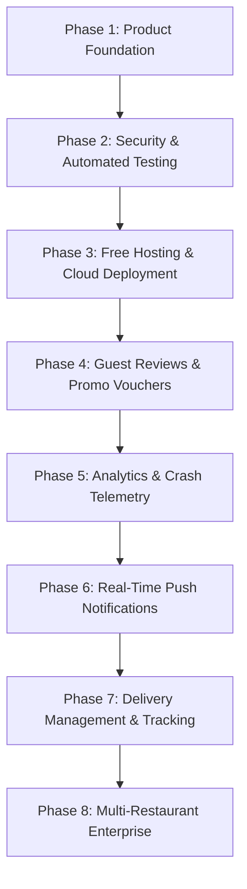

# Free Stack Architecture & Service Directory

> **Zero-Cost Production Blueprint**: Complete architectural blueprint for deploying, hosting, building, monitoring, and scaling the **AURA Restaurant Platform** entirely on free-tier, developer-friendly cloud infrastructure.  
> **Guiding Principle**: Zero paid subscriptions, zero mandatory credit card commitments, zero vendor lock-in. Every integration has a perpetually free tier with a graceful fallback.

---

## 1. Core Service Matrix (Free Services)

The table below outlines free-tier infrastructure choices for every architectural capability required by the platform:

| Capability | Free Provider / Option | Prerequisites & Setup | Known Free Tier Limits *(verify current limits)* |
| :--- | :--- | :--- | :--- |
| **Database** | **MongoDB Atlas M0 Free Cluster** | Free MongoDB Cloud account; create shared M0 cluster in nearest AWS/GCP region (`eu-central-1` or `ap-south-1`); generate DB user & IP whitelist (`0.0.0.0/0`). | 512 MB storage, shared RAM/vCPU, 100 max concurrent connections, no auto-scaling. *(verify current limits on MongoDB pricing page)* |
| **API Hosting** | **Render.com Web Service** (Alt: Fly.io / Railway trial / Koyeb) | GitHub OAuth; link repository; set root directory to `server`; environment variables (`MONGO_URI`, `JWT_SECRET`, `NODE_ENV=production`). | 750 free instance hours/month, 512 MB RAM, spins down to sleep after 15 min of inactivity (cold start ~30s on first hit). *(verify current limits on Render pricing page)* |
| **App Builds & Updates** | **Expo Application Services (EAS) Free Tier** | Free Expo developer account (`expo login`); configured `eas.json`. | 30 free Android cloud builds/month, 15 iOS cloud builds/month (requires free Apple ID for ad-hoc / simulator builds); unlimited OTA updates up to 1,000 monthly active users (MAU). *(verify current limits on Expo EAS pricing page)* |
| **Push Notifications** | **Expo Push Notification Service** | Native Expo Push Token API (`expo-notifications`); zero APNs/FCM server maintenance needed. | Completely free and unlimited via Expo's shared push infrastructure. *(verify current limits on Expo documentation)* |
| **Image Storage** | **Cloudinary Free Tier** (Alt: Supabase Storage / ImgBB) | Free Cloudinary account; obtain `CLOUD_NAME`, `API_KEY`, and unsigned upload preset; integrate with `src/utils/imageUpload.js`. | 25 Monthly Credits (~25 GB managed storage or 25,000 transformations/month), global CDN delivery included. *(verify current limits on Cloudinary pricing page)* |
| **Email Dispatch** | **Resend Free Tier** (Alt: Brevo / SendGrid / Nodemailer Gmail SMTP) | Free Resend account; generate API key; send transaction emails (welcome, booking receipts, password reset). | 3,000 emails/month (100 emails/day) using `onboarding@resend.dev` or a verified free domain. *(verify current limits on Resend pricing page)* |
| **Continuous Integration (CI)** | **GitHub Actions** | `.github/workflows/ci.yml` in repository; triggers on push/PR to `main` and `product-foundation`. | 2,000 free runner minutes/month for private repos (unlimited for public repos); standard Ubuntu Linux runners. *(verify current limits on GitHub Actions billing page)* |
| **Error Tracking & Observability** | **Sentry Developer Free Tier** (Alt: GlitchTip open-source) | Free Sentry account; install `@sentry/react-native` and `@sentry/node`; configure DSN. | 5,000 error events/month, 10,000 performance transactions/month, 1 user seat, 30 days retention. *(verify current limits on Sentry pricing page)* |
| **Maps & Geolocation** | **Leaflet / OpenStreetMap** (Client) & **Nominatim** (Geocoding) | No API key required; React Native WebView or `react-native-maps` with OSM tile overlay URL `https://tile.openstreetmap.org/{z}/{x}/{y}.png`. | Free community rate limit (max 1 request/second for Nominatim geocoding; standard caching headers required). *(verify current limits on OpenStreetMap usage policy)* |

---

## 2. Paid Realities & Zero-Cost Fallbacks

Certain mobile commerce and communication services possess **no perpetual free tier** in production. The following table pairs each commercial requirement with an immediate, production-ready **free fallback**:

| Commercial Service | Paid Requirement | Why Not Free | Free Fallback Implementation |
| :--- | :--- | :--- | :--- |
| **SMS Gateway** | Twilio, MessageBird, Zong/Jazz SMS API | Cellular telecommunication carriers bill per outbound SMS delivery. | **Email OTP & In-App WhatsApp Deep-Linking**: Deliver 6-digit cryptographic verification codes via free email (Resend / Brevo) or open pre-filled WhatsApp concierge chats via `Linking.openURL('https://wa.me/<number>?text=...')`. During local development, print OTPs safely to the server console. |
| **Payment Gateways** | Stripe, PayFast, JazzCash, EasyPaisa Merchant | Transaction merchant fees (typically 2.5% – 3.5% + fixed interchange fee) and commercial merchant registration. | **Cash on Delivery / Pay-at-Table / Direct Bank Transfer Upload**: Support Dine-In settlement at the table, Counter Pay, and manual customer screenshot upload for bank transfers verified by managers via dashboard. |
| **Custom Domain & SSL** | Namecheap, GoDaddy, Cloudflare Registrar ($10–$15/year) | Top-Level Domain (TLD) registries (ICANN, PKNIC) charge annual registration fees. | **Provider Managed Subdomains**: Use platform subdomains with free automated Let's Encrypt wildcard SSL (`aura-api.onrender.com` or `aura-bistro.vercel.app`). |
| **Apple App Store & Google Play Fees** | Apple Developer Program ($99/year), Google Play Console ($25 one-time) | Platform vendor developer account licensing. | **Direct Android APK Distribution & Expo Web PWA**: Distribute standalone signed Android `.apk` files directly via GitHub Releases or hosted QR download links; deploy responsive Expo Web build as a Progressive Web App (PWA) installable on both iOS and Android home screens without app store submission. |

---

## 3. Prioritised Roadmap (Next Phases)

A structured, dependency-ordered evolution roadmap for taking the platform from Product Foundation to production enterprise deployment:

### Phase 2: Security Hardening & Automated Testing
- **Backend Test Suite**: Implement Jest & Supertest integration suites covering authentication, reservation double-booking prevention, and order calculations.
- **Frontend Test Suite**: Component snapshot and interaction tests using React Native Testing Library.
- **Security Hardening**: Enforce rate limiting (`express-rate-limit`) on auth routes, tighten CORS, and ensure zero unhandled promise rejections.
- **CI Pipeline**: GitHub Actions workflow running linting, typechecking, and tests on every pull request.

### Phase 3: Free Hosting & Cloud Deployment
- **API Deployment**: Deploy Express backend to Render.com free web service connected to MongoDB Atlas M0 cluster.
- **Keep-Alive Worker**: Free GitHub Actions scheduled cron (every 14 minutes) or UptimeRobot monitor to prevent cold starts during peak dining hours.
- **Web App Hosting**: Deploy Expo Web production bundle to Vercel or Cloudflare Pages with zero-cost global edge caching.
- **Automated EAS Build Script**: Setup automated scripts for building standalone Android APKs on GitHub Releases.

### Phase 4: Reviews, Ratings & Loyalty Vouchers
- **Dish Review Engine**: 1-to-5 star ratings with verified diner badges and feedback text stored under dishes.
- **Promotional Coupon System**: Dynamic discount codes (`WELCOME10`, `EMERALDVIP`) validated by subtotal and expiry dates.
- **Loyalty Points Accrual**: Automated calculation of points earned per completed bill, displayed on profile badges.

### Phase 5: Analytics & Crash Telemetry
- **Error Monitoring**: Sentry SDK integration for React Native client and Express server with breadcrumbs and error capture.
- **Product Telemetry**: Lightweight self-hosted or free privacy-focused analytics (e.g. PostHog free cloud tier with 1M events/month or Aptabase open-source mobile analytics).
- **Executive Metrics**: Conversion funnel analytics (menu view $\rightarrow$ tray add $\rightarrow$ checkout placed).

### Phase 6: Push Notifications & Real-Time Alerts
- **Expo Push Tokens**: Store push tokens linked to user accounts upon permission grant.
- **Order Lifecycle Triggers**: Background dispatches to customers when orders transition (`Preparing` $\rightarrow$ `Ready` $\rightarrow$ `Served`).
- **Reservation Reminders**: Automated notifications 2 hours prior to confirmed booking timeslots.
- **Manager Alerts**: Real-time push alert to staff devices when high-value orders or VIP reservations arrive.

### Phase 7: Delivery Management & Live Route Tracking
- **Order Types Extension**: Full fulfillment support for Doorstep Delivery alongside Dine-in, Takeaway, and Curbside.
- **Driver Dispatch Interface**: Dedicated driver status view for marking pickup and successful delivery.
- **OpenStreetMap Route View**: Display delivery rider distance and estimated arrival time using open routing engines (OSRM / OpenRouteService free tiers).

### Phase 8: Multi-Restaurant & Enterprise Scaling
- **Tenant Isolation**: Support independent restaurant tenants with customizable branding, menus, and operating hours.
- **Role Hierarchy**: Fine-grained RBAC for multi-location managers, shift supervisors, kitchen display operators, and cashiers.
- **Cross-City Analytics**: Consolidated regional revenue and kitchen performance reports across outlets.
