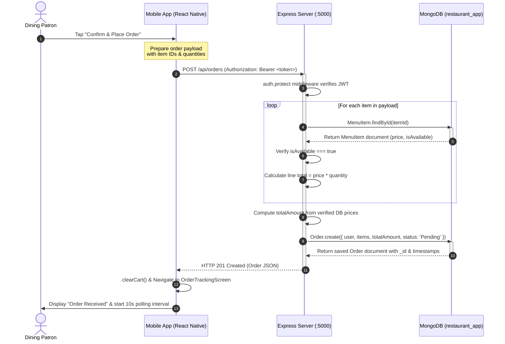
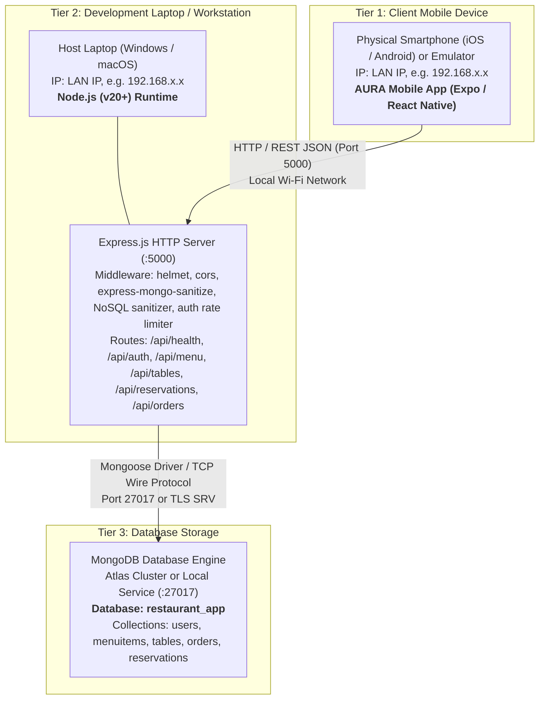

# Software Requirements Specification (SRS v2.0)
## AURA: Artisan Kitchen & Modern Botanica
### Client-Server Architecture (React Native, Node.js, Express, MongoDB)

**Document Version:** 2.0.0 (Assignment 2 Submission)  
**Academic Term:** Fall 2026  
**Course:** Mobile Application Development (CS-375)  
**Student Name:** Syed Obaid Ali  
**Roll Number:** 9321  
**Instructor:** Dr. Sadaf Tanvir  

---

## Executive Summary & Problem Resolution

In **Assignment 1 (A1)**, the AURA Restaurant Application operated strictly as a standalone mobile MVP. All business records—menu catalogs, patron profiles, cart states, table bookings, and kitchen orders—were kept in local mock files and client-side device storage (`AsyncStorage`).

### Real-World Problems Observed in A1:
1. **Multi-Device Data Desynchronization:**  
   *Problem:* When the Restaurant Manager changed the price of a dish or toggled an ingredient as sold out on their device, dining customers on other phones still observed the old price and could continue ordering unavailable items.
2. **Cross-Device Order Invisibility:**  
   *Problem:* When a customer placed an order on one phone, checking on another family member's phone or reinstalling the app showed an empty tray. The orders were trapped in the local sandbox of a single phone.
3. **Table Double-Booking Hazard:**  
   *Problem:* Two patrons attempting to book the same private window booth at 19:00 on the same date could both succeed simultaneously because each phone checked only its local memory.
4. **Data Loss on Reinstall / Cache Clear:**  
   *Problem:* Uninstalling or clearing app storage wiped out all reservation history and customer loyalty records.

### How Assignment 2 (A2) Resolves Every Problem:
By introducing a centralized **Node.js + Express REST API server** connected to a **MongoDB database**:
* **Single Source of Truth:** All devices read from and write to the same central database.
* **Instant Menu Updates:** When a manager updates a price or toggles availability via `PUT /api/menu/:id`, the database updates immediately, and any patron pulling to refresh sees the updated catalog.
* **Synchronized Orders & 10s Polling:** Orders are stored in MongoDB. The customer's `OrderTrackingScreen` polls `GET /api/orders/my` every 10 seconds, immediately displaying when the kitchen advances the status from `Preparing` to `Ready`.
* **Server-Side Collision Detection:** When a booking is submitted via `POST /api/reservations`, the server checks whether the table is already occupied for that date and time. If occupied, the server returns an **HTTP 409 Conflict**, preventing double-bookings.

---

## 1. Introduction

### 1.1. Purpose
This Software Requirements Specification (SRS v2.0) establishes the full functional, database, and architectural requirements for the connected **AURA Restaurant Mobile Application**. It provides developers, evaluators, and system architects with a blueprint of the integrated system comprising an Expo/React Native cross-platform mobile client, an Express.js HTTP backend, and a MongoDB NoSQL database.

### 1.2. Scope

#### In-Scope Functionalities (Updated for A2):
1. **Centralized Backend REST API:** A production-grade Node.js and Express server running on port 5000, modularized into `config/`, `models/`, `routes/`, `controllers/`, and `middleware/`.
2. **MongoDB Database Persistence:** Centralized NoSQL database (`restaurant_app`) with strict Mongoose schemas for `User`, `MenuItem`, `Table`, `Reservation`, and `Order`.
3. **Secure Authentication & Token Management:** Password encryption with `bcryptjs` (salt rounds = 10) and stateless user authentication using signed **JSON Web Tokens (JWT)** expiring in 24 hours.
4. **Role-Based Access Control Middleware:** Custom Express middleware `protect` (verifies `Bearer <token>` headers) and `managerOnly` (enforces administrative authorization with HTTP 403 Forbidden).
5. **Dynamic Menu Catalog & Management:** Public endpoints for categorized retrieval and case-insensitive search (`/api/menu?category=...&search=...`), with manager-only protected endpoints for creating, editing, and deleting dishes.
6. **Validated Order Pipeline:** Server-side order calculation using database menu prices (ignoring untrusted client calculations), rejection of sold-out items, and monotonic state progression (`Pending` ➔ `Preparing` ➔ `Ready` ➔ `Served`). An order can only be set to `Cancelled` while its status is `Pending`.
7. **Collision-Proof Table Reservations:** Server validation ensuring seat capacity requirements and blocking double-bookings with HTTP 409 Conflict.
8. **Automated Live Status Polling:** Client-side 10-second polling intervals (`setInterval`) on `OrderTrackingScreen` to provide real-time kitchen status synchronization without manual restarts.
9. **Mobile API Client & Custom Hooks:** Centralized HTTP client (`src/api/client.js`) and reusable data-fetching hook (`src/hooks/useApi.js`) handling loading, error, and refetch lifecycles across screens.
10. **Phone OTP Authentication (Extra Feature):** A Pakistani mobile phone number OTP login flow beyond the assignment requirements. The server generates a cryptographically secure 6-digit numeric code using `crypto.randomInt(100000, 1000000)`, stores it in an in-memory `Map` (not in the database), and prints the code exclusively to the server console as a simulated SMS gateway (not returned in response). The OTP is valid for 5 minutes with a 30-second resend cooldown and strict 6-digit format validation (`/^\d{6}$/`). After verification (strictly invalidated after 3 incorrect attempts), the server either logs in the existing user or creates a new customer account automatically, returning a JWT token.
11. **Config-Driven Multi-Branch Architecture (Extra Feature):** Comprehensive multi-outlet operational support (`src/config/brand.js`, `BranchContext`). Allows patrons to choose their active dining branch (e.g., Lahore Gulberg vs. Islamabad F-7) with persistence (`@aura_selected_branch_id`). Orders and reservations are tagged with immutable branch metadata (`branchId`, `branchName`, `branchCity`). Restaurant Managers can monitor live kitchen operations across all branches or filter by specific outlet from an executive supervision dashboard.

#### Out-of-Scope (Excluded from A2):
1. **Real Payment Gateways:** Real credit card transactions (Stripe, JazzCash, EasyPaisa) remain out of scope; orders are placed with simulated payment processing.
2. **Native Push Notifications:** Push daemons (Apple APNs, Google FCM) remain out of scope; polling intervals are used for status tracking.
3. **GPS Courier Live Tracking:** External delivery fleet tracking is excluded.

---

### 1.3. Definitions, Acronyms, and Abbreviations

1. **API (Application Programming Interface):** A set of rules and protocols that allows the React Native mobile application to communicate with the Express backend server.
2. **REST (Representational State Transfer):** An architectural style for networked applications that utilizes standard HTTP verbs (GET, POST, PUT, PATCH, DELETE) to manage resources represented as JSON.
3. **Endpoint:** A specific URL location (e.g., `http://192.168.1.15:5000/api/menu`) on a server where the API receives requests and sends responses.
4. **JSON (JavaScript Object Notation):** A lightweight, human-readable data-interchange text format used for serializing request payloads and API responses between client and server.
5. **MongoDB:** A document-oriented, NoSQL database that stores data in flexible, JSON-like BSON documents grouped into collections.
6. **Collection:** A grouping of MongoDB documents, analogous to a table in a relational database system (e.g., `menuitems`, `orders`).
7. **Mongoose:** An Object Data Modeling (ODM) library for Node.js and MongoDB that provides schema validation, type casting, middleware hooks, and business logic methods.
8. **Middleware:** Functions that execute during the Express request-response lifecycle, having access to `req`, `res`, and the `next` function (e.g., authentication, error handling, JSON parsing).
9. **JWT (JSON Web Token):** A compact, URL-safe means of representing claims between two parties. Encoded with a secret key (`JWT_SECRET`) to securely authenticate users without storing server-side sessions.
10. **HTTP Status Code:** Standardized 3-digit numerical responses from the server indicating the outcome of a request (e.g., `200 OK`, `201 Created`, `400 Bad Request`, `401 Unauthorized`, `403 Forbidden`, `404 Not Found`, `409 Conflict`, `500 Server Error`).
11. **Bcrypt:** A cryptographic hash function designed specifically for password storage, incorporating salting to protect against rainbow table attacks.
12. **CORS (Cross-Origin Resource Sharing):** A security mechanism allowing web and mobile applications running on different ports or origins to interact with the backend API.

---

## 2. Overall Description & System Actors

### 2.1. System Actors & Roles
* **Customer / Dining Patron:** A registered user who logs in to browse the real-time menu catalog, filter dishes, customize cart items, place Dine-in/Takeaway orders, track order progression via 10-second polling, and book dining tables.
* **Restaurant Operations Manager:** An authenticated administrative user who oversees incoming kitchen orders, advances order stages (`Pending` ➔ `Preparing` ➔ `Ready` ➔ `Served`), accepts or declines table bookings, updates item prices, and toggles dish availability.

---

## 3. Functional Requirements

### Module 1: Authentication & Authorization
* **FR-01 (User Registration):** `POST /api/auth/register` shall validate name, unique email, password, and optional phone. The server always creates role `customer`; any client-provided `role` field is ignored. Passwords must be hashed using `bcryptjs` before storage. Duplicate emails must return HTTP 409 Conflict.
* **FR-02 (User Login):** `POST /api/auth/login` shall verify email and password against MongoDB. Successful logins return a signed JWT expiring in 24 hours, along with user details (`id`, `name`, `email`, `role`). The password hash must never be returned.
* **FR-03 (Token Verification):** The `protect` middleware shall inspect the `Authorization: Bearer <token>` header, verify token authenticity using `JWT_SECRET`, and attach the user record to `req.user`. Invalid or missing tokens return HTTP 401.
* **FR-04 (Role Enforcement):** The `managerOnly` middleware shall verify that `req.user.role === 'manager'`. Unauthorized non-manager roles return HTTP 403 Forbidden.

### Module 2: Menu Catalog & CRUD
* **FR-05 (Public Menu Listing):** `GET /api/menu` shall return all active menu items. It must accept optional query parameters: `category` (case-insensitive filter) and `search` (case-insensitive regular expression matching dish name).
* **FR-06 (Single Item Retrieval):** `GET /api/menu/:id` shall validate the MongoDB ObjectId format. If valid and existing, it returns the item; if non-existent, it returns HTTP 404; if invalid format, it returns HTTP 400.
* **FR-07 (Manager Menu Mutations):** `POST /api/menu` (201 Created), `PUT /api/menu/:id` (200 OK), and `DELETE /api/menu/:id` (200 OK) shall require both `protect` and `managerOnly` middleware.

### Module 3: Order Pipeline & Validation
* **FR-08 (Order Creation):** `POST /api/orders` shall accept order items, dining type, and table number. The server must verify that each dish exists and `isAvailable === true`. The server must calculate the total price directly from MongoDB dish prices, ignoring client-submitted totals.
* **FR-09 (Monotonic Progression):** `PATCH /api/orders/:id/status` shall enforce that orders progress strictly forward: `Pending` ➔ `Preparing` ➔ `Ready` ➔ `Served`. An order can only be set to `Cancelled` while in `Pending` state. A manager advances the status forward; a customer can set only `Cancelled` on their own `Pending` order within a 10-minute cancellation window. Any illegal transition returns HTTP 400.
* **FR-10 (Order Queries):** Customers retrieve their orders via `GET /api/orders/my`. Managers retrieve all restaurant orders via `GET /api/orders`.
* **FR-11 (Live Polling):** The mobile `OrderTrackingScreen` shall execute `GET /api/orders/my` every 10 seconds via `setInterval` and clear the timer upon unmount.

### Module 4: Table Reservations & Collision Prevention
* **FR-12 (Table Availability Check):** `POST /api/reservations` shall check whether the requested table has sufficient seating capacity and is unbooked for that specific date and hourly time slot. If a booking exists with status `Pending` or `Confirmed`, the server returns **HTTP 409 Conflict**.
* **FR-13 (Reservation Management):** Customers view their reservations via `GET /api/reservations/my`. Managers view all reservations via `GET /api/reservations`. Status is updated via `PATCH /api/reservations/:id`: a manager can set `Confirmed` or `Declined` on any booking; a customer can set only `Cancelled` on their own booking.

---

## 5. Database Design (Replaces Section 5 of A1)

The mock arrays from A1 are now fully realized as normalized MongoDB collections in the `restaurant_app` database:

### Table 5.1: Database Collections & Schema Definitions

| Collection | Fields & Types | Relationships, Constraints & Validation Rules |
|---|---|---|
| **Users** (`users`) | • `_id`: ObjectId (PK) • `name`: String (Required, Trim) • `email`: String (Required, Unique, Lowercase, Trim) • `password`: String (Required, Hashed with bcrypt) • `role`: String (Enum: `['customer', 'manager']`, Default: `'customer'`) • `phone`: String (Optional, Trim, Default: `''`) • `dob`: String (Optional, Trim, Default: `''`) • `membership`: String (Default: `'Member'`) • `avatar`: String (Default: Unsplash placeholder URL) • `isActive`: Boolean (Default: `true`) • `createdAt`: Date (Auto) • `updatedAt`: Date (Auto) | • **Unique Constraint:** `email` is indexed and unique. • **Security:** Passwords are never returned in responses. • **Account Status:** Disabled users (`isActive: false`) are denied login and API access with HTTP 401. • **Parent of:** `Orders` (1:N) and `Reservations` (1:N). |
| **MenuItems** (`menuitems`) | • `_id`: ObjectId (PK) • `name`: String (Required, Trim) • `description`: String (Required, Trim) • `price`: Number (Required, Min: 0) • `category`: String (Required, Enum: `['Starters', 'Mains', 'Desserts', 'Drinks']`) • `image`: String (Required, URL format) • `isSpecial`: Boolean (Default: `false`) • `isAvailable`: Boolean (Default: `true`) • `prepTime`: String (Default: `'15 min'`) • `rating`: Number (Min: 0, Max: 5, Default: 4.8) • `tag`: String (Optional, Trim) • `createdAt` & `updatedAt`: Date | • **Validation Rule:** `price` must be non-negative (`min: [0, 'Price cannot be negative']`). • **Indexes:** Text index on `{name, description}` for search; index on `{category: 1}` for filter queries. • **Referenced by:** `Order.items.menuItem`. |
| **Tables** (`tables`) | • `_id`: ObjectId (PK) • `tableNumber`: String (Required, Unique, Trim, e.g. `'A-01'`) • `name`: String (Required, Trim, e.g. `'Atrium Glasshouse Window'`) • `seats`: Number (Required, Min: 1) • `location`: String (Required, Trim) • `isWindow`: Boolean (Default: `false`) • `isAvailable`: Boolean (Default: `true`) • `createdAt` & `updatedAt`: Date | • **Unique Constraint:** `tableNumber` is unique across the restaurant. • **Capacity Rule:** `seats` determines maximum allowable party size. • **Referenced by:** `Reservation.table`. |
| **Reservations** (`reservations`) | • `_id`: ObjectId (PK) • `user`: ObjectId (FK ➔ `User`, Required) • `customerName`: String (Optional, Trim) • `phone`: String (Optional, Trim) • `table`: ObjectId (FK ➔ `Table`, Required) • `date`: String (Required, Format: `YYYY-MM-DD`) • `time`: String (Required, Format: `HH:mm`) • `guests`: Number (Required, Min: 1) • `specialRequests`: String (Optional, Trim) • `status`: String (Enum: `['Pending', 'Confirmed', 'Cancelled', 'Declined']`, Default: `'Pending'`) • `createdAt` & `updatedAt`: Date (`timestamps: true`) | • **Relational Integrity:** Links `User` and `Table` documents. • **Collision Rule (Q7):** Unique compound partial index on `{table, date, time}` where `status` is `Pending` or `Confirmed` blocks double-booking with HTTP 409. • **Indexes:** `{user: 1}`, `{date: 1, time: 1}`. • **Capacity Rule:** `table.seats >= guests`. |
| **Orders** (`orders`) | • `_id`: ObjectId (PK) • `user`: ObjectId (FK ➔ `User`, Required) • `customerName`: String (Optional, Trim) • `items`: Array of Subdocuments: &nbsp;&nbsp;– `menuItem`: ObjectId (FK ➔ `MenuItem`) &nbsp;&nbsp;– `name`: String &nbsp;&nbsp;– `price`: Number &nbsp;&nbsp;– `quantity`: Number (Min: 1) &nbsp;&nbsp;– `specialInstructions`: String • `totalAmount`: Number (Required, Calculated on server) • `orderType`: String (Enum: `['Dine-in', 'Takeaway', 'Dine-In Table', 'Curbside', 'Priority']`, Default: `'Dine-in'`) • `tableNumber`: String (Optional, Trim) • `status`: String (Enum: `['Pending', 'Preparing', 'Ready', 'Served', 'Cancelled']`, Default: `'Pending'`) • `notes`: String (Optional, Trim) • `createdAt` & `updatedAt`: Date (`timestamps: true`) | • **Monotonic State Machine:** Status strictly moves `Pending` ➔ `Preparing` ➔ `Ready` ➔ `Served`. `Cancelled` is only valid when currently `Pending`. • **Security Rule:** `totalAmount` is calculated by multiplying DB item prices with quantity on the backend. • **Indexes:** `{user: 1, createdAt: -1}`, `{status: 1}`. |

---

## 6. Architectural Diagrams

### 6.1. Sequence Diagram: Customer Places an Order (Q1 Requirement)
This diagram illustrates the message sequence with the **three required lifelines**: the **Mobile App**, the **Express Server**, and **MongoDB**.

---

### 6.2. Deployment Diagram (Q1 Requirement)
This diagram depicts the physical deployment topology linking the **Mobile Device**, the **Development Laptop Server**, and the **Database Host**.

---

## 8. API Endpoints Specification (New Section 8)

The table below documents all **26 REST API endpoints** implemented in the backend server:

> *Note: The SRS PDF cannot be edited directly and must be regenerated from this markdown/HTML source.*

| # | HTTP Method | Endpoint Route | Access Level | Request Body (Payload) | Response Structure & Status |
|---|---|---|---|---|---|
| **1** | `GET` | `/api/health` | Public | None | `200 OK`: `{ "status": "ok", "time": "2026-10-07T..." }` |
| **2** | `POST` | `/api/auth/register` | Public | `{ name, email, password, phone? }` | `201 Created`: `{ token, user: { _id, name, email, role } }` `409 Conflict`: If email exists |
| **3** | `POST` | `/api/auth/login` | Public | `{ email, password }` | `200 OK`: `{ token, user: { _id, name, email, role } }` `401 Unauthorized`: Invalid credentials or Account disabled |
| **4** | `GET` | `/api/auth/me` | Private (Customer/Manager) | None (Bearer Token) | `200 OK`: `{ user: { _id, name, email, role, phone, dob, membership, avatar, isActive } }` |
| **5** | `PUT` | `/api/auth/profile` | Private (Customer/Manager) | `{ name?, phone?, dob?, avatar? }` | `200 OK`: `{ message, user }` — Updates current user profile. |
| **6** | `DELETE` | `/api/auth/profile` | Private (Customer/Manager) | None (Bearer Token) | `200 OK`: `{ success: true, message }` — Permanently removes user account. |
| **7** | `GET` | `/api/auth/staff` | Private (Manager Only) | None (Bearer Token) | `200 OK`: `User[]` — Lists managers (`name, email, role, isActive`) without passwords. |
| **8** | `POST` | `/api/auth/staff` | Private (Manager Only) | `{ name, email, password }` | `201 Created`: `{ user }` — Creates a new manager account. |
| **9** | `PATCH` | `/api/auth/staff/:id` | Private (Manager Only) | `{ isActive?, role? }` | `200 OK`: `{ user }` — Updates status (deactivate/reactivate) or demotes to customer. Guarded against self-action and disabling the last manager. |
| **10** | `POST` | `/api/auth/phone/send-otp` | Public | `{ phone }` | `200 OK`: `{ success, message, phone }` — Generates 6-digit cryptographic OTP with 30s resend cooldown, prints exclusively to server console as simulated SMS. |
| **11** | `POST` | `/api/auth/phone/verify-otp` | Public | `{ phone, otp, name? }` | `200 OK` or `201 Created`: `{ token, user, isNewUser }` — Verifies 6-digit OTP (invalidated after 3 incorrect attempts) and logs in or creates customer account. |
| **12** | `GET` | `/api/menu` | Public | None (Optional Query: `?category=...&search=...`) | `200 OK`: Array of `MenuItem` objects |
| **13** | `POST` | `/api/menu` | Private (Manager Only) | `{ name, description, price, category, image, isSpecial?, isAvailable?, prepTime?, rating?, tag? }` | `201 Created`: Created `MenuItem` document `403 Forbidden`: If called by customer |
| **14** | `GET` | `/api/menu/:id` | Public | None | `200 OK`: Single `MenuItem` object `400 Bad Request`: Invalid ObjectId `404 Not Found`: Item does not exist |
| **15** | `PUT` | `/api/menu/:id` | Private (Manager Only) | Partial updates: `{ price?, isAvailable?, ... }` | `200 OK`: Updated `MenuItem` document |
| **16** | `DELETE` | `/api/menu/:id` | Private (Manager Only) | None | `200 OK`: `{ message: "Menu item deleted successfully" }` |
| **17** | `GET` | `/api/tables` | Public | None | `200 OK`: Array of all dining `Table` objects |
| **18** | `POST` | `/api/reservations` | Private (Customer/Manager) | `{ tableId, date, time, guests, specialRequests?, customerName?, phone?, branchId?, branchName? }` | `201 Created`: Populated `Reservation` document `409 Conflict`: Table already booked for slot |
| **19** | `GET` | `/api/reservations` | Private (Manager Only) | None | `200 OK`: Array of all restaurant bookings |
| **20** | `GET` | `/api/reservations/my` | Private (Customer) | None | `200 OK`: Array of customer's own bookings |
| **21** | `PATCH` | `/api/reservations/:id` | Private (Customer/Manager) | `{ status }` (`Confirmed`, `Declined`, `Cancelled`) | `200 OK`: Updated `Reservation` — Manager sets `Confirmed`/`Declined`; customer sets only `Cancelled` on own booking. |
| **22** | `POST` | `/api/orders` | Private (Customer/Manager) | `{ items: [{ menuItem, quantity, specialInstructions? }], orderType?, tableNumber?, notes?, branchId?, branchName?, branchCity? }` | `201 Created`: Verified `Order` document with server-computed `totalAmount` and branch association |
| **23** | `GET` | `/api/orders` | Private (Manager Only) | None | `200 OK`: Array of all restaurant `Order` documents |
| **24** | `GET` | `/api/orders/my` | Private (Customer) | None | `200 OK`: Array of customer's own `Order` documents |
| **25** | `PATCH` | `/api/orders/:id/status` | Private (Customer/Manager) | `{ status }` (`Pending`, `Preparing`, `Ready`, `Served`, `Cancelled`) | `200 OK`: Updated `Order` — Manager advances status forward monotonically; customer can set only `Cancelled` on own `Pending` order within 10-minute window. `400 Bad Request`: Illegal status jump |
| **26** | `POST` | `/api/upload` | Private (Manager Only) | `multipart/form-data` with `image` file | `201 Created`: `{ message, imageUrl, filename, size, mimetype }` — Uploads and stores manager dish photos in `server/uploads/` with 5MB max size and MIME type validation (`jpeg, png, webp`). |

---

## 9. Verification & Viva Voce Defense Guide

### Key Questions Evaluators Ask & Verified Implementations:

1. **"Why do we calculate order total on the server instead of accepting the client's cart total?"**  
   *Answer:* Client applications run on untrusted end-user hardware. A malicious user or tampered request could modify prices in memory (e.g., changing a Rs. 3,650 steak to Rs. 1). The server verifies the authoritative price from MongoDB before writing `totalAmount` into the database.

2. **"How do you prevent table double-bookings during peak hours?"**  
   *Answer:* In `server/controllers/reservationController.js`, before creating a record, we query MongoDB for any active booking (`Pending` or `Confirmed`) matching the same `table._id`, `date`, and `time`. If an overlapping record exists, the server immediately halts and returns an **HTTP 409 Conflict**, preventing concurrent collision.

3. **"Where is the custom `useApi` hook used in the mobile client?"**  
   *Answer:* It is integrated in two distinct screens: `MenuScreen.js` (for loading menu items and triggering pull-to-refresh) and `ManagerDashboardScreen.js` (for retrieving all dining reservations with live acceptance and rejection controls).

4. **"How does the customer receive kitchen status updates in real-time?"**  
   *Answer:* In `OrderTrackingScreen.js`, a `useEffect` hook initializes a 10-second `setInterval` that polls `GET /api/orders/my`. As soon as the manager marks an order as `Preparing` or `Ready`, the customer's state machine advances automatically without requiring app reloads.

5. **"How does the app handle dish image uploads from a phone/laptop like KFC or FoodPanda?"**  
   *Answer:* Rather than expecting managers to host web images manually, `expo-image-picker` allows managers to pick photos directly from device storage. The picker automatically crops to a 4:3 standard aspect ratio and compresses to 70% quality (reducing 15 MB raw camera files to ~200 KB). The client uploads it via `multipart/form-data` to `POST /api/upload`, where `multer` validates the MIME type and stores it under `server/uploads/`. The public URL is returned and saved to the dish in MongoDB.
